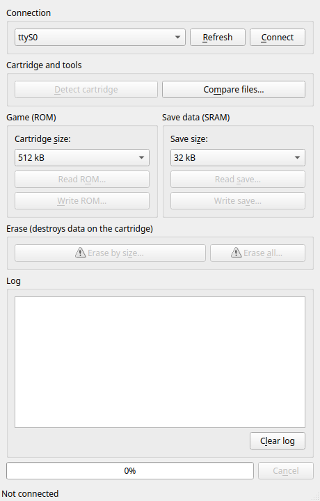

# md_rewriter

**Idiomas / Языки / 语言 / Languages / भाषाएँ / زبانیں:** [Português (Brasil)](#português-brasil) · [Русский](#русский) · [简体中文](#简体中文) · [English](#english) · [हिन्दी](#हिन्दी) · [اردو](#اردو)

---

<a id="português-brasil"></a>
# Português (Brasil)

Ferramenta portátil para cartuchos de Sega Mega Drive: faz backup e restauração de ROMs e de jogos salvos (saves) no seu computador e grava ROMs em cartuchos flash regraváveis de terceiros.

## Componentes

| Pasta | Conteúdo |
|-------|----------|
| `legacy_firmware/` | Código-fonte do firmware do microcontrolador (STM32F103VB, projeto Keil). O firmware compilado está na página de releases: [Release 1.0](https://github.com/Epicjoy/md_rewriter/releases/download/1.0/md-rewriter-firmware-1.0.hex). |
| `Hardware/` | BOM, Gerber e arquivos da PCB. Você pode fabricar a placa conforme sua necessidade. |
| `Software/` | Aplicativo de computador (Qt 6). Funciona em **Linux** e Windows. |
| `docs/` | Especificação e plano das correções, e notas técnicas. |

Loja oficial da Epicjoy no AliExpress: [comprar](https://s.click.aliexpress.com/e/_c314U0QB)

Projeto irmão: [oscr_minimal](https://github.com/legendaryredfox/oscr_minimal) é um leitor e gravador de cartuchos de SNES, NES, Famicom, Mega Drive e GBA em um shield para Arduino Mega, baseado no Open Source Cartridge Reader. As descobertas de bancada deste projeto sobre cartuchos de Mega Drive estão documentadas lá (`docs/referencia/megadrive-bancada-md-rewriter.md`), e o suporte a cartuchos de até 8 MiB é planejado nele.

Gostou do projeto? Apoie: [Buy Me a Coffee](https://buymeacoffee.com/legendaryredfox)

## Recursos

- Sem restrição de região: cartuchos dos EUA, do Japão e da Europa.
- Faz backup de jogos de cartuchos de Mega Drive para o computador e grava jogos em cartuchos flash regraváveis de terceiros.
- Lê e grava os dados de save (SRAM) do cartucho.
- Compara dois arquivos byte a byte (por exemplo, uma leitura e a ROM original), sem precisar do dispositivo.
- Grava ROMs de qualquer tamanho par e converte arquivos `.smd`, e verifica a gravação lendo o cartucho de volta. **Nos cartuchos flash da família KY / FlashKit cabem no máximo 2 MiB de jogo** (limite da placa do cartucho, não do programa): veja o [guia passo a passo](docs/guide/pt-BR.md#8-o-limite-de-2-mib-dos-cartuchos-flash).
- Interface que segue o tema do sistema (claro ou escuro), com confirmação antes de qualquer operação destrutiva e botão Cancelar para leituras e gravações.
- Guia do usuário embutido (menu **Ajuda → Guia do usuário** ou **F1**): receitas de uso, o que cada mensagem do registro significa e solução de problemas, com busca. Disponível em português e inglês.
- Linha de comando (`mdrewriter-cli`) com a mesma sessão do aplicativo, saída `--json` e códigos de saída fixos, pensada para scripts e agentes de IA: veja `docs/CLI.md`.
- Firmware nova (`firmware_1.1/`): grava cartuchos flash S29GL064N de uma vez só e verifica, e nomeia mais chips. Testada na primeira unidade (placa, cartucho original só para leitura, dois cartuchos flash); lista de chips em `docs/CART_SUPPORT.md`, resultados em `docs/HWTEST.md`.
- **[Guia passo a passo, da caixa ao primeiro jogo](docs/guide/pt-BR.md)**: soldagem, montagem e desmontagem, instalação do firmware 1.1 com o ST-Link e todos os testes (interface gráfica e linha de comando).
- Código aberto.



## Instalação do aplicativo

### Linux (testado no Linux Mint 22 com Qt 6.4)

```bash
sudo apt install build-essential qt6-base-dev qt6-serialport-dev qt6-tools-dev qt6-l10n-tools
cd Software
qmake6 MDRewriter.pro
make -j"$(nproc)"
./MDRewriter                 # executar sem instalar
sudo make install            # opcional: instala em /usr/local (programa, ícone, atalho e regra udev)
```

**Permissão para acessar a porta serial.** O dispositivo aparece como `/dev/ttyACM0` (ou similar). Escolha **uma** das opções:

1. Adicione seu usuário ao grupo `dialout` e faça login novamente: `sudo usermod -aG dialout $USER`
2. Ou instale a regra udev incluída, que também impede o ModemManager de usar a porta:
   ```bash
   sudo cp Software/linux/99-md-rewriter.rules /etc/udev/rules.d/
   sudo udevadm control --reload && sudo udevadm trigger
   ```
   Depois reconecte o cabo USB.

### Windows

Baixe o programa pronto na página de releases, ou abra `Software/MDRewriter.pro` no Qt Creator e compile. O Windows reconhece o dispositivo como uma porta COM (instale o driver "STM32 Virtual ComPort" se necessário).

### Gerar pacotes (.deb, Windows, macOS)

Só o pacote Linux foi construído e testado nesta máquina. As etapas de Windows e macOS abaixo seguem a documentação do Qt, mas **não foram executadas** neste projeto; se algo falhar, abra uma issue.

**Linux (.deb).** O script usa a versão de `Software/MDRewriter.pro`, faz o build de release com prefixo `/usr` e inclui programa, atalho, ícone, regra udev e licença:

```bash
sudo apt install build-essential qt6-base-dev qt6-serialport-dev qt6-tools-dev qt6-l10n-tools dpkg-dev fakeroot
tools/package-deb.sh                        # build/dist/mdrewriter_<version>_amd64.deb + .sha256
sudo apt install ./build/dist/mdrewriter_*_amd64.deb
```

**Windows (.zip e .msi).** Instale o Qt 6.4 ou mais novo pelo instalador oficial (kit MinGW 64-bit e o módulo Qt Serial Port) e abra o prompt "Qt 6.x (MinGW 64-bit)". O `windeployqt` copia as DLLs do Qt para a pasta, que então vira um `.zip` portátil:

```bat
rem "Qt 6.x (MinGW 64-bit)" prompt from the Qt installer (Qt 6.4 or newer, with Qt Serial Port)
mkdir build & cd build
qmake ..\Software\MDRewriter.pro
mingw32-make release
mkdir MDRewriter & copy release\MDRewriter.exe MDRewriter\
windeployqt --release MDRewriter\MDRewriter.exe
powershell Compress-Archive MDRewriter MDRewriter-windows-x64.zip
```

Para um `.msi`, empacote essa pasta com o [WiX Toolset](https://wixtoolset.org/) v4 ou mais novo (um arquivo `MDRewriter.wxs` que lista `MDRewriter.exe`, as DLLs e `platforms\`, `styles\` etc.). Este repositório ainda não inclui o `.wxs`. (O Inno Setup ou o NSIS também servem se você prefere um instalador `.exe`.) Com o WiX instalado:

```bat
dotnet tool install --global wix
wix build MDRewriter.wxs -o MDRewriter.msi
```

**macOS (.dmg).** Instale o Qt 6 (por exemplo com o Homebrew). O `qmake` gera `MDRewriter.app` e o `macdeployqt` embute o Qt e cria o `.dmg`. O app sai sem assinatura: o Gatekeeper pede "Abrir" com o botão direito, e assinar e notarizar exige uma conta de desenvolvedor Apple (`macdeployqt -codesign=...`). A porta aparece como `/dev/cu.usbmodem*`. Ainda não há ícone `.icns` no projeto.

```bash
brew install qt                              # Qt 6 with Qt Serial Port
mkdir build && cd build
"$(brew --prefix qt)/bin/qmake" ../Software/MDRewriter.pro CONFIG+=release
make -j"$(sysctl -n hw.ncpu)"
"$(brew --prefix qt)/bin/macdeployqt" MDRewriter.app -dmg      # MDRewriter.dmg
```

## Como usar

1. **Conecte o MD Rewriter** ao computador por USB e **insira o cartucho** no dispositivo.
2. Abra o **MD Rewriter**. A lista de portas se atualiza sozinha; a porta do dispositivo (USB `0483:5740`, "STM32 Virtual ComPort") é escolhida automaticamente. Se não aparecer, clique em **Atualizar**.
3. Clique em **Conectar**. O registro mostra "Device identified." e os botões de ação são habilitados. Os botões ficam desabilitados enquanto não houver conexão ou durante uma operação.
4. Clique em **Detectar cartucho** para identificar o chip flash (mostra o ID do chip e o modelo, quando conhecido). O firmware 1.0 só reconhece o chip MX29LV640EB e mostra `NO FIND NGP CARD` para os demais, mas isso não impede nada: o programa nomeia outros chips pelo ID (por exemplo ST M29W640D) e explica o resultado.

### Fazer backup de um jogo (ler a ROM)

1. Em **Jogo (ROM)**, escolha o **Tamanho do cartucho** (512 KiB, 1 MiB, 2 MiB ou 4 MiB).
2. Clique em **Ler ROM…** e escolha onde salvar o arquivo (`.bin`).
3. Acompanhe a barra de progresso. O arquivo só é criado quando a leitura termina completa e sem erros. Se você cancelar ou ocorrer uma falha, **nenhum arquivo parcial** é deixado.

### Gravar um jogo em um cartucho flash

1. **Apague o cartucho antes** se ele não estiver vazio (veja abaixo).
2. Clique em **Gravar ROM…** e escolha o arquivo (`.bin`, `.md`, `.gen` ou `.smd`). Antes de gravar, o programa detecta o chip flash e compara sua capacidade e os comandos conhecidos com a ROM. Ele bloqueia incompatibilidades conhecidas e pede confirmação quando não consegue ter certeza. Qualquer ROM de tamanho par entre 512 bytes e 8 MiB é aceita (mais de 4 MiB exige o firmware 1.1) (256 KiB, 768 KiB, 1,5 MiB etc.): ela é gravada como está e o resto do chip fica em branco. Arquivos `.smd` são convertidos para ROM simples. O programa avisa, sem bloquear, se o cabeçalho parecer errado (sem `SEGA`, checksum ruim, arquivo truncado). **Atenção:** nos cartuchos flash da família KY / FlashKit só cabem 2 MiB; acima disso a gravação falha (guia, seção 8).
3. Confirme o aviso. A barra mostra o progresso; **Cancelar** interrompe, mas deixa o cartucho com uma imagem parcial.
4. Com **Verificar após gravar** marcado (padrão), o programa lê o cartucho de volta e compara com o arquivo; o registro mostra "Verified" ou o primeiro deslocamento que difere.

### Apagar o cartucho

- **Apagar por tamanho…**: apaga apenas os setores flash do tamanho escolhido em "Tamanho do cartucho". Mais rápido.
- **Apagar tudo…**: apaga o chip flash inteiro e a memória de save. Pode levar vários minutos e **não pode ser cancelado**. Não desconecte o dispositivo durante o processo.

Os dois pedem confirmação, pois **destroem os dados do cartucho**.

### Dados de save (SRAM)

- Escolha o **Tamanho do save** (32 KiB ou 8 KiB) e use **Ler save…** para copiar os saves do cartucho para um arquivo (`.srm`).
- **Gravar save…** substitui os saves do cartucho pelo conteúdo de um arquivo de 8 KiB ou 32 KiB (pede confirmação).

### Comparar arquivos

**Comparar arquivos…** pergunta por dois arquivos e lista as primeiras 20 diferenças (posição do byte). Serve para conferir se uma leitura é idêntica à ROM original. Não precisa do dispositivo.

### Solução de problemas

| Sintoma | O que fazer |
|---------|-------------|
| "permission denied" ao conectar (Linux) | Grupo `dialout` ou regra udev (seção de instalação). |
| A porta não aparece | Troque o cabo (use um com dados, não só de carga), reconecte e clique em **Atualizar**. |
| "the device did not answer" | A porta está errada ou o firmware não está gravado no dispositivo. |
| Leitura "incompleta ou fora de sincronia" | Use outro cabo/porta USB e tente de novo; o arquivo não é salvo nesse caso. |
| "The cartridge did not finish erasing in time" | O cartucho pode estar com defeito ou não ser flash (requer firmware que envie esse aviso; o firmware novo envia). |
| Usar uma porta que o sistema não lista | Defina `MD_REWRITER_EXTRA_PORT=/caminho/da/porta` antes de abrir o programa. |

## Ligar o ST-Link V2 (gravar o firmware)

O firmware só pode ser gravado por SWD. A PCB V1.0 tem 4 pads furados soltos, sem serigrafia, em uma fileira vertical logo abaixo do capacitor C10: à direita do microcontrolador (U1) e acima do conector USB-C. Vista de cima (USB-C embaixo):

```
   ●  3V3
   ●  SWCLK   (PA14, U1 pin 76)
   ●  SWDIO   (PA13, U1 pin 72)
   ●  GND
 [USB-C]
```

| Pad (de cima para baixo) | Rede | Fio do ST-Link V2 |
|--------------------------|------|-------------------|
| 1 | 3V3 | 3.3V (só se o USB estiver desligado) |
| 2 | SWCLK (PA14) | SWCLK |
| 3 | SWDIO (PA13) | SWDIO |
| 4 | GND | GND |

- Pelo verso da placa a ordem vertical é a mesma (3V3 em cima, GND embaixo); a fileira só aparece espelhada.
- Não há pad de NRST: deixe o RST do ST-Link solto. Não ligue o 5V do ST-Link.
- Alimente a placa por **uma** fonte só: ou USB-C com o fio 3V3 do ST-Link desconectado (ligue só GND, SWCLK e SWDIO), ou o 3V3 do ST-Link sem USB.
- A ordem dos pads foi tirada do arquivo do projeto (`Hardware/PCB`). Confirme com o multímetro antes de ligar: GND tem continuidade com a carcaça do USB-C, e 3V3 mostra 3,3 V com o USB ligado.

### Mapa de pinos do ST-Link V2

| Sinal | Pad da PCB | ST-Link V2 original (conector de 20 pinos) | ST-Link V2 clone (dongle USB) |
|-------|-----------|-------------------------------------------|-------------------------------|
| SWCLK | 2 | pino 9 (TCK/SWCLK) | o pino marcado `SWCLK` |
| SWDIO | 3 | pino 7 (TMS/SWDIO) | o pino marcado `SWDIO` (às vezes `SWIO`) |
| GND | 4 | pino 4 (também 6, 8, 10, 12, 14, 16, 18, 20) | o pino marcado `GND` |
| 3V3 | 1 | pino 1 (só referência de tensão: não alimenta a placa) | o pino marcado `3.3V` (saída; use só sem USB) |
| NRST | sem pad | pino 15 (deixar solto) | `RST` (deixar solto) |

Os clones em forma de dongle USB (4, 6 ou 10 pinos) **não seguem** a numeração de 20 pinos, e a ordem dos pinos muda de um modelo para outro. Ligue sempre pelo nome impresso na carcaça. Se não houver nome, descubra com o multímetro. Muitos clones nem têm o sinal NRST.

Teste a conexão e faça o backup do firmware original **antes** de gravar qualquer coisa:

```bash
st-info --probe                                          # STM32F1xx medium-density, 128 KiB (0x20000)
st-flash read backup_fw_1.0.bin 0x08000000 0x20000
```

Se a leitura vier vazia, a proteção de leitura está ligada: não apague nada. Detalhes e passos seguintes em `docs/NEW_FIRMWARE_PLAN.md` (passo 2) e `firmware_1.1/README.md`.

## Desenvolvimento e testes

```bash
cd Software/tests
qmake6 tests.pro && make -j"$(nproc)" && make check     # unitários, integração e ponta a ponta
cd ../.. && tools/check-firmware.sh                      # verificação estática do firmware (arm-none-eabi-gcc, cppcheck)
```

- `tst_protocol`: unitários (comandos, tabelas de tamanhos, analisador de fluxo, comparador).
- `tst_session`: integração (sessão do dispositivo contra um firmware simulado, com respostas fragmentadas, falhas e cancelamento).
- `tst_help`: guia embutido (estrutura, idiomas, links) e verificação de que as mensagens e teclas citadas no guia existem no programa.
- `tst_cli`: linha de comando (`mdrewriter-cli` contra um firmware simulado).
- `tst_e2e`: ponta a ponta (janela real + porta serial real em um pseudo-terminal + firmware simulado; apenas Linux). Defina `QT_QPA_PLATFORM=offscreen` para rodar sem tela.

O firmware 1.1 foi testado na primeira unidade: resultados em `docs/HWTEST.md`; protocolo em `docs/PROTOCOL.md`.

Firmware novo (`firmware_1.1/`): `cd firmware_1.1 && make test && ./check.sh` roda os testes no PC (o `MD.c` real contra um modelo de chip flash) e a verificação estática. O firmware foi executado na primeira unidade (2026-11-13): resultados em `docs/HWTEST.md`; pendências e plano em `docs/NEW_FIRMWARE_PLAN.md` e `docs/NEW_FIRMWARE_SPEC.md`.

Quando o hardware chegar: `tools/hwtest/hwtest.py` (`nocart`, `cart`) roda testes de bancada **somente de leitura** pela CLI, sem nunca gravar nem apagar o cartucho; veja `docs/HWTEST.md`.

## Licença

Licença [MIT](LICENSE). O código de terceiros em `legacy_firmware/Drivers` e `legacy_firmware/Middlewares` (STMicroelectronics, ARM) mantém as licenças originais.

---

<a id="русский"></a>
# Русский

Портативный инструмент для картриджей Sega Mega Drive: резервное копирование и восстановление ROM и сохранений на вашем компьютере, а также запись ROM на сторонние перезаписываемые flash-картриджи.

## Состав проекта

| Папка | Содержимое |
|-------|------------|
| `legacy_firmware/` | Исходный код прошивки микроконтроллера (STM32F103VB, проект Keil). Готовая прошивка — в разделе релизов: [Release 1.0](https://github.com/Epicjoy/md_rewriter/releases/download/1.0/md-rewriter-firmware-1.0.hex). |
| `Hardware/` | BOM, Gerber и файлы печатной платы. Плату можно изготовить самостоятельно. |
| `Software/` | Программа для компьютера (Qt 6). Работает в **Linux** и Windows. |
| `docs/` | Спецификация и план исправлений, технические заметки. |

Официальный магазин Epicjoy на AliExpress: [купить](https://s.click.aliexpress.com/e/_c314U0QB)

Проект-побратим: [oscr_minimal](https://github.com/legendaryredfox/oscr_minimal) — считыватель и программатор картриджей SNES, NES, Famicom, Mega Drive и GBA на плате-шилде для Arduino Mega, основанный на Open Source Cartridge Reader. Стендовые находки этого проекта о картриджах Mega Drive описаны там (`docs/referencia/megadrive-bancada-md-rewriter.md`), а поддержка картриджей до 8 МиБ запланирована в нём.

Нравится проект? Поддержите: [Buy Me a Coffee](https://buymeacoffee.com/legendaryredfox)

## Возможности

- Без региональных ограничений: картриджи США, Японии и Европы.
- Резервное копирование игр с картриджей Mega Drive на компьютер и запись игр на сторонние перезаписываемые картриджи.
- Чтение и запись сохранений (SRAM) картриджа.
- Побайтовое сравнение двух файлов (например, дампа и оригинальной ROM) — устройство не нужно.
- Записывает ROM любого чётного размера и преобразует файлы `.smd`, проверяет запись обратным чтением картриджа. **На flash-картриджи семейства KY / FlashKit помещается не более 2 МиБ игры** (ограничение платы картриджа, а не программы): см. [пошаговое руководство](docs/guide/ru.md#8-предел-2-миб-у-flash-картриджей).
- Интерфейс использует системную тему (светлую или тёмную), запрашивает подтверждение перед любой разрушающей операцией, а чтение и запись можно отменить кнопкой «Cancel».
- Встроенное руководство (меню **Help → User guide** или **F1**): сценарии использования, значение сообщений журнала и устранение неполадок, с поиском. Доступно на португальском и английском.
- Командная строка (`mdrewriter-cli`) с той же сессией, что и в программе, вывод `--json` и фиксированные коды возврата — для скриптов и ИИ-агентов: см. `docs/CLI.md`.
- Новая прошивка (`firmware_1.1/`): записывает flash-картриджи S29GL064N за один проход с проверкой и называет больше микросхем. Проверена на первом устройстве (плата, оригинальный картридж только для чтения, два flash-картриджа); список микросхем в `docs/CART_SUPPORT.md`, результаты в `docs/HWTEST.md`.
- **[Пошаговое руководство, от коробки до первой игры](docs/guide/ru.md)**: пайка, сборка и разборка, установка прошивки 1.1 через ST-Link и все тесты (графическая программа и командная строка).
- Открытый исходный код.


## Установка программы

### Linux (проверено на Linux Mint 22 с Qt 6.4)

```bash
sudo apt install build-essential qt6-base-dev qt6-serialport-dev qt6-tools-dev qt6-l10n-tools
cd Software
qmake6 MDRewriter.pro
make -j"$(nproc)"
./MDRewriter                 # запуск без установки
sudo make install            # по желанию: установка в /usr/local (программа, значок, ярлык и правило udev)
```

**Доступ к последовательному порту.** Устройство появляется как `/dev/ttyACM0` (или аналогичное). Выберите **один** из вариантов:

1. Добавьте пользователя в группу `dialout` и заново войдите в систему: `sudo usermod -aG dialout $USER`
2. Либо установите входящее в проект правило udev; оно же не даёт ModemManager занимать порт:
   ```bash
   sudo cp Software/linux/99-md-rewriter.rules /etc/udev/rules.d/
   sudo udevadm control --reload && sudo udevadm trigger
   ```
   После этого переподключите USB-кабель.

### Windows

Скачайте готовую программу в разделе релизов или откройте `Software/MDRewriter.pro` в Qt Creator и соберите проект. Windows определяет устройство как COM-порт (при необходимости установите драйвер «STM32 Virtual ComPort»).

### Сборка пакетов (.deb, Windows, macOS)

На машине автора собран и проверен только пакет для Linux. Шаги для Windows и macOS ниже следуют документации Qt, но для этого проекта **не выполнялись**; если что-то не работает, создайте issue.

**Linux (.deb).** Скрипт берёт версию из `Software/MDRewriter.pro`, делает release-сборку с префиксом `/usr` и упаковывает программу, ярлык, иконку, правило udev и лицензию:

```bash
sudo apt install build-essential qt6-base-dev qt6-serialport-dev qt6-tools-dev qt6-l10n-tools dpkg-dev fakeroot
tools/package-deb.sh                        # build/dist/mdrewriter_<version>_amd64.deb + .sha256
sudo apt install ./build/dist/mdrewriter_*_amd64.deb
```

**Windows (.zip и .msi).** Установите Qt 6.4 или новее официальным установщиком (комплект MinGW 64-bit и модуль Qt Serial Port) и откройте консоль «Qt 6.x (MinGW 64-bit)». `windeployqt` копирует DLL Qt рядом с программой, а папка превращается в переносимый `.zip`:

```bat
rem "Qt 6.x (MinGW 64-bit)" prompt from the Qt installer (Qt 6.4 or newer, with Qt Serial Port)
mkdir build & cd build
qmake ..\Software\MDRewriter.pro
mingw32-make release
mkdir MDRewriter & copy release\MDRewriter.exe MDRewriter\
windeployqt --release MDRewriter\MDRewriter.exe
powershell Compress-Archive MDRewriter MDRewriter-windows-x64.zip
```

Для `.msi` упакуйте эту папку с помощью [WiX Toolset](https://wixtoolset.org/) v4 или новее (файл `MDRewriter.wxs`, перечисляющий `MDRewriter.exe`, DLL и каталоги `platforms\`, `styles\` и т. д.). Файла `.wxs` в репозитории пока нет. (Подойдут и Inno Setup или NSIS, если нужен установщик `.exe`.) Когда WiX установлен:

```bat
dotnet tool install --global wix
wix build MDRewriter.wxs -o MDRewriter.msi
```

**macOS (.dmg).** Установите Qt 6 (например, через Homebrew). `qmake` создаёт `MDRewriter.app`, а `macdeployqt` встраивает Qt и создаёт `.dmg`. Приложение не подписано: Gatekeeper потребует открыть его правой кнопкой («Открыть»), а подпись и нотаризация требуют аккаунта разработчика Apple (`macdeployqt -codesign=...`). Порт виден как `/dev/cu.usbmodem*`. Иконки `.icns` в проекте пока нет.

```bash
brew install qt                              # Qt 6 with Qt Serial Port
mkdir build && cd build
"$(brew --prefix qt)/bin/qmake" ../Software/MDRewriter.pro CONFIG+=release
make -j"$(sysctl -n hw.ncpu)"
"$(brew --prefix qt)/bin/macdeployqt" MDRewriter.app -dmg      # MDRewriter.dmg
```

## Как пользоваться

1. **Подключите MD Rewriter** к компьютеру по USB и **вставьте картридж** в устройство.
2. Запустите **MD Rewriter**. Список портов обновляется сам; порт устройства (USB `0483:5740`, «STM32 Virtual ComPort») выбирается автоматически. Если порта нет, нажмите **Refresh**.
3. Нажмите **Connect**. В журнале появится «Device identified.», и кнопки действий станут доступны. Без соединения и во время операции кнопки неактивны.
4. Нажмите **Detect cartridge**, чтобы определить flash-микросхему (показываются её ID и модель, если она известна). Прошивка 1.0 распознаёт только MX29LV640EB и для любой другой микросхемы пишет `NO FIND NGP CARD`, но это ничего не блокирует: программа называет другие микросхемы по ID (например, ST M29W640D) и объясняет результат.

### Резервная копия игры (чтение ROM)

1. В группе **Game (ROM)** выберите **Cartridge size** (512 KiB, 1 MiB, 2 MiB или 4 MiB).
2. Нажмите **Read ROM…** и выберите, куда сохранить файл (`.bin`).
3. Следите за индикатором выполнения. Файл создаётся только после полного и безошибочного чтения. При отмене или сбое **неполный файл не остаётся**.

### Запись игры на flash-картридж

1. Если картридж не пуст, **сначала сотрите его** (см. ниже).
2. Нажмите **Write ROM…** и выберите файл (`.bin`, `.md`, `.gen` или `.smd`). Перед записью программа определяет флеш-микросхему и сверяет её ёмкость и известные команды с ROM. Известные несовместимости она блокирует, а если не уверена, просит подтверждения. Принимается любой ROM чётного размера от 512 байт до 8 MiB (больше 4 MiB требует прошивку 1.1) (256 KiB, 768 KiB, 1,5 MiB и т. д.): он записывается как есть, остальная часть микросхемы остаётся чистой. Файлы `.smd` автоматически преобразуются в обычный ROM. Если заголовок выглядит неверно (нет `SEGA`, неверная контрольная сумма, файл обрезан), программа предупреждает, но запись не блокирует. С включённой опцией **Verify after writing** (по умолчанию) программа после записи читает картридж обратно и сравнивает с файлом. **Внимание:** на flash-картриджи семейства KY / FlashKit помещается только 2 МиБ; больше записать не удастся (руководство, раздел 8).
3. Подтвердите предупреждение. **Cancel** прервёт запись, но на картридже останется неполный образ.

### Стирание картриджа

- **Erase by size…** — стирает только flash-секторы выбранного в «Cartridge size» объёма. Быстрее.
- **Erase all…** — стирает всю flash-микросхему и память сохранений. Может занять несколько минут и **не может быть отменено**. Не отключайте устройство во время стирания.

Обе операции требуют подтверждения, так как **уничтожают данные на картридже**.

### Сохранения (SRAM)

- Выберите **Save size** (32 KiB или 8 KiB) и нажмите **Read save…**, чтобы скопировать сохранения с картриджа в файл (`.srm`).
- **Write save…** заменяет сохранения на картридже содержимым файла размером 8 KiB или 32 KiB (с подтверждением).

### Сравнение файлов

**Compare files…** запрашивает два файла и показывает первые 20 различий (смещение байта). Удобно, чтобы убедиться, что дамп совпадает с оригинальной ROM. Устройство не требуется.

### Устранение неполадок

| Симптом | Что делать |
|---------|-----------|
| «permission denied» при подключении (Linux) | Группа `dialout` или правило udev (раздел установки). |
| Порт не появляется | Смените кабель (нужен кабель с данными, а не только зарядный), переподключите и нажмите **Refresh**. |
| «the device did not answer» | Выбран не тот порт, или в устройство не записана прошивка. |
| Чтение «incomplete or out of sync» | Попробуйте другой кабель/USB-порт ещё раз; файл в этом случае не сохраняется. |
| Порт, которого нет в списке системы | Задайте `MD_REWRITER_EXTRA_PORT=/путь/к/порту` перед запуском. |

## Подключение ST-Link V2 (прошивка)

Прошить устройство можно только по SWD. На плате V1.0 есть 4 отдельные сквозные контактные площадки без маркировки, расположенные вертикальным рядом сразу под конденсатором C10: справа от микроконтроллера (U1) и над разъёмом USB-C. Вид сверху (USB-C внизу):

```
   ●  3V3
   ●  SWCLK   (PA14, U1 pin 76)
   ●  SWDIO   (PA13, U1 pin 72)
   ●  GND
 [USB-C]
```

| Площадка (сверху вниз) | Цепь | Провод ST-Link V2 |
|------------------------|------|-------------------|
| 1 | 3V3 | 3.3V (только если USB отключён) |
| 2 | SWCLK (PA14) | SWCLK |
| 3 | SWDIO (PA13) | SWDIO |
| 4 | GND | GND |

- С обратной стороны платы порядок по вертикали тот же (3V3 сверху, GND снизу); ряд виден зеркально.
- Площадки NRST нет: вывод RST ST-Link оставьте свободным. 5V ST-Link не подключайте.
- Питайте плату только от **одного** источника: либо USB-C при отключённом проводе 3V3 ST-Link (подключите только GND, SWCLK и SWDIO), либо 3V3 от ST-Link без USB.
- Порядок площадок взят из файла проекта (`Hardware/PCB`). Перед подключением проверьте мультиметром: GND звонится с корпусом USB-C, а на 3V3 при включённом USB есть 3,3 В.

### Распиновка ST-Link V2

| Сигнал | Площадка на плате | Оригинальный ST-Link V2 (20-контактный разъём) | Клон ST-Link V2 (USB-донгл) |
|--------|-------------------|-----------------------------------------------|-----------------------------|
| SWCLK | 2 | контакт 9 (TCK/SWCLK) | контакт с надписью `SWCLK` |
| SWDIO | 3 | контакт 7 (TMS/SWDIO) | контакт с надписью `SWDIO` (иногда `SWIO`) |
| GND | 4 | контакт 4 (также 6, 8, 10, 12, 14, 16, 18, 20) | контакт с надписью `GND` |
| 3V3 | 1 | контакт 1 (только опорное напряжение: плату не питает) | контакт с надписью `3.3V` (выход; только без USB) |
| NRST | нет площадки | контакт 15 (оставить свободным) | `RST` (оставить свободным) |

Клоны в виде USB-донгла (4, 6 или 10 контактов) **не следуют** 20-контактной нумерации, а порядок контактов у разных моделей разный. Всегда подключайте по надписям на корпусе. Если надписей нет, определите контакты мультиметром. У многих клонов сигнала NRST вообще нет.

Проверьте соединение и сделайте резервную копию оригинальной прошивки **до** любой записи:

```bash
st-info --probe                                          # STM32F1xx medium-density, 128 KiB (0x20000)
st-flash read backup_fw_1.0.bin 0x08000000 0x20000
```

Если чтение вернуло пустой результат, включена защита от чтения: ничего не стирайте. Подробности и следующие шаги: `docs/NEW_FIRMWARE_PLAN.md` (шаг 2) и `firmware_1.1/README.md`.

## Разработка и тесты

```bash
cd Software/tests
qmake6 tests.pro && make -j"$(nproc)" && make check     # модульные, интеграционные и сквозные тесты
cd ../.. && tools/check-firmware.sh                      # статическая проверка прошивки (arm-none-eabi-gcc, cppcheck)
```

- `tst_protocol` — модульные тесты (команды, таблицы размеров, разбор потока, сравнение файлов).
- `tst_session` — интеграционные тесты (сессия устройства с имитацией прошивки: фрагментация ответов, сбои, отмена).
- `tst_help` — встроенное руководство (структура, языки, ссылки) и проверка того, что сообщения и клавиши из руководства есть в программе.
- `tst_cli` — командная строка (`mdrewriter-cli` с имитацией прошивки).
- `tst_e2e` — сквозные тесты (настоящее окно + настоящий последовательный порт на псевдотерминале + имитация прошивки; только Linux). Для запуска без экрана задайте `QT_QPA_PLATFORM=offscreen`.

Прошивка 1.1 проверена на первом устройстве: результаты в `docs/HWTEST.md`; протокол в `docs/PROTOCOL.md`.

Новая прошивка (`firmware_1.1/`): `cd firmware_1.1 && make test && ./check.sh` запускает тесты на ПК (настоящий `MD.c` против модели flash-микросхемы) и статическую проверку. Прошивка запускалась на первом устройстве (13.11.2026): результаты в `docs/HWTEST.md`; незавершённое и план — в `docs/NEW_FIRMWARE_PLAN.md` и `docs/NEW_FIRMWARE_SPEC.md`.

Когда оборудование будет под рукой: `tools/hwtest/hwtest.py` (`nocart`, `cart`) запускает стендовые тесты **только на чтение** через CLI и никогда не пишет и не стирает картридж; см. `docs/HWTEST.md`.

## Лицензия

Лицензия [MIT](LICENSE). Сторонний код в `legacy_firmware/Drivers` и `legacy_firmware/Middlewares` (STMicroelectronics, ARM) сохраняет исходные лицензии.

---

<a id="简体中文"></a>
# 简体中文

便携式 Sega Mega Drive（世嘉 MD）卡带工具：可在电脑上备份和恢复游戏 ROM 与存档，并把 ROM 写入第三方可重复擦写的 Flash 卡带。

## 项目组成

| 目录 | 内容 |
|------|------|
| `legacy_firmware/` | 单片机固件源码（STM32F103VB，Keil 工程）。编译好的固件见发布页：[Release 1.0](https://github.com/Epicjoy/md_rewriter/releases/download/1.0/md-rewriter-firmware-1.0.hex)。 |
| `Hardware/` | BOM、Gerber 和 PCB 文件，可按需自行制板。 |
| `Software/` | 上位机软件（Qt 6），支持 **Linux** 和 Windows。 |
| `docs/` | 修复规格说明与计划、技术说明。 |

Epicjoy 官方速卖通店铺：[购买](https://s.click.aliexpress.com/e/_c314U0QB)

姊妹项目：[oscr_minimal](https://github.com/legendaryredfox/oscr_minimal) 是基于 Open Source Cartridge Reader、做成 Arduino Mega 扩展板的 SNES、NES、Famicom、Mega Drive 和 GBA 卡带读写器。本项目关于 Mega Drive 卡带的测试台发现记录在那边（`docs/referencia/megadrive-bancada-md-rewriter.md`），并且计划在那里支持最大 8 MiB 的卡带。

喜欢这个项目？欢迎支持：[Buy Me a Coffee](https://buymeacoffee.com/legendaryredfox)

## 功能

- 无区域限制，兼容美版、日版和欧版卡带。
- 将 MD 卡带中的游戏备份到电脑，或写入第三方可重复擦写的卡带。
- 读取并备份卡带存档（SRAM），方便管理。
- 逐字节比较两个文件（例如读出的文件与原始 ROM），无需连接设备。
- 可写入任意偶数大小的 ROM，自动转换 `.smd` 文件，并在写入后把卡带读回进行校验。**KY / FlashKit 系列闪存卡最多只能存放 2 MiB 的游戏**（这是卡带电路板的限制，不是程序的问题）：见[分步指南](docs/guide/zh-Hans.md#8-闪存卡的-2-mib-限制)。
- 界面跟随系统主题（浅色或深色）；任何破坏性操作前都会确认，读写过程可点击“Cancel”取消。
- 内置用户指南（菜单 **Help → User guide** 或按 **F1**）：使用场景、日志信息含义和故障排除，支持搜索。提供葡萄牙语和英语版本。
- 命令行 `mdrewriter-cli`：与图形界面使用同一会话，支持 `--json` 输出和固定的退出码，适合脚本和 AI 代理，详见 `docs/CLI.md`。
- 新固件（`firmware_1.1/`）：一次写好 S29GL064N 闪存卡并校验，识别更多芯片。已在第一台设备上测试（开发板、只读的原装卡带、两张闪存卡）；芯片清单见 `docs/CART_SUPPORT.md`，结果见 `docs/HWTEST.md`。
- **[从开箱到第一个游戏的分步指南](docs/guide/zh-Hans.md)**：焊接、组装与拆卸、用 ST-Link 安装固件 1.1，以及全部测试（图形程序和命令行）。
- 开源。


## 安装软件

### Linux（已在 Linux Mint 22、Qt 6.4 上测试）

```bash
sudo apt install build-essential qt6-base-dev qt6-serialport-dev qt6-tools-dev qt6-l10n-tools
cd Software
qmake6 MDRewriter.pro
make -j"$(nproc)"
./MDRewriter                 # 不安装直接运行
sudo make install            # 可选：安装到 /usr/local（程序、图标、启动项和 udev 规则）
```

**串口权限。** 设备会显示为 `/dev/ttyACM0`（或类似名称）。请任选**一种**方式：

1. 把当前用户加入 `dialout` 组并重新登录：`sudo usermod -aG dialout $USER`
2. 或安装随附的 udev 规则（同时可防止 ModemManager 占用该串口）：
   ```bash
   sudo cp Software/linux/99-md-rewriter.rules /etc/udev/rules.d/
   sudo udevadm control --reload && sudo udevadm trigger
   ```
   然后重新插拔 USB 线。

### Windows

在发布页下载编译好的程序，或用 Qt Creator 打开 `Software/MDRewriter.pro` 自行编译。Windows 会把设备识别为 COM 口（必要时安装“STM32 Virtual ComPort”驱动）。

### 构建安装包（.deb、Windows、macOS）

只有 Linux 安装包在维护者的机器上构建并测试过。下面的 Windows 和 macOS 步骤遵循 Qt 文档，但本项目**尚未实际运行**；如果失败，请提交 issue。

**Linux（.deb）。** 脚本从 `Software/MDRewriter.pro` 读取版本号，以前缀 `/usr` 做 release 构建，并打包程序、桌面入口、图标、udev 规则和许可证：

```bash
sudo apt install build-essential qt6-base-dev qt6-serialport-dev qt6-tools-dev qt6-l10n-tools dpkg-dev fakeroot
tools/package-deb.sh                        # build/dist/mdrewriter_<version>_amd64.deb + .sha256
sudo apt install ./build/dist/mdrewriter_*_amd64.deb
```

**Windows（.zip 和 .msi）。** 用官方安装器安装 Qt 6.4 或更新版本（MinGW 64-bit 套件和 Qt Serial Port 模块），并打开“Qt 6.x (MinGW 64-bit)”命令行。`windeployqt` 会把 Qt 的 DLL 复制到程序旁边，该文件夹即可压缩为便携的 `.zip`：

```bat
rem "Qt 6.x (MinGW 64-bit)" prompt from the Qt installer (Qt 6.4 or newer, with Qt Serial Port)
mkdir build & cd build
qmake ..\Software\MDRewriter.pro
mingw32-make release
mkdir MDRewriter & copy release\MDRewriter.exe MDRewriter\
windeployqt --release MDRewriter\MDRewriter.exe
powershell Compress-Archive MDRewriter MDRewriter-windows-x64.zip
```

要生成 `.msi`，请用 [WiX Toolset](https://wixtoolset.org/) v4 或更新版本打包该文件夹（一个列出 `MDRewriter.exe`、各 DLL 以及 `platforms\`、`styles\` 等目录的 `MDRewriter.wxs`）。仓库里暂时没有 `.wxs`。（如果想要 `.exe` 安装程序，也可以用 Inno Setup 或 NSIS。）安装好 WiX 后：

```bat
dotnet tool install --global wix
wix build MDRewriter.wxs -o MDRewriter.msi
```

**macOS（.dmg）。** 安装 Qt 6（例如通过 Homebrew）。`qmake` 生成 `MDRewriter.app`，`macdeployqt` 嵌入 Qt 并创建 `.dmg`。应用未签名：Gatekeeper 会要求右键选择“打开”；签名和公证需要 Apple 开发者账号（`macdeployqt -codesign=...`）。端口显示为 `/dev/cu.usbmodem*`。项目里还没有 `.icns` 图标。

```bash
brew install qt                              # Qt 6 with Qt Serial Port
mkdir build && cd build
"$(brew --prefix qt)/bin/qmake" ../Software/MDRewriter.pro CONFIG+=release
make -j"$(sysctl -n hw.ncpu)"
"$(brew --prefix qt)/bin/macdeployqt" MDRewriter.app -dmg      # MDRewriter.dmg
```

## 使用方法

1. 用 USB 线把 **MD Rewriter 连接到电脑**，并把**卡带插入**设备。
2. 打开 **MD Rewriter**。端口列表会自动刷新，设备端口（USB `0483:5740`，“STM32 Virtual ComPort”）会被自动选中。如果没有出现，请点击 **Refresh**。
3. 点击 **Connect**。日志中出现“Device identified.”后，操作按钮即可使用。未连接或操作进行中时，按钮为灰色。
4. 点击 **Detect cartridge** 识别 Flash 芯片（显示芯片 ID，已知时还会显示型号）。固件 1.0 只认识 MX29LV640EB，其他芯片都会显示 `NO FIND NGP CARD`，但这不会阻止任何操作：程序会根据 ID 给出其他芯片的名称（例如 ST M29W640D）并解释结果。

### 备份游戏（读取 ROM）

1. 在 **Game (ROM)** 中选择 **Cartridge size**（512 KiB、1 MiB、2 MiB 或 4 MiB）。
2. 点击 **Read ROM…**，选择保存位置（`.bin` 文件）。
3. 观察进度条。只有读取完整且无错误时才会生成文件；若取消或出错，**不会留下不完整的文件**。

### 向 Flash 卡带写入游戏

1. 如果卡带不是空白的，请**先擦除**（见下文）。
2. 点击 **Write ROM…** 并选择文件（`.bin`、`.md`、`.gen` 或 `.smd`）。写入前，程序会检测闪存芯片，并把它已知的容量和命令支持与 ROM 对照：已知不兼容时会阻止写入，无法确定时会请你确认。支持 512 字节到 8 MiB 之间任何偶数大小的 ROM（超过 4 MiB 需要固件 1.1）（256 KiB、768 KiB、1.5 MiB 等）：按原样写入，芯片其余部分保持空白。`.smd` 文件会自动转换为普通 ROM。如果文件头看起来不对（没有 `SEGA`、校验和错误、文件被截断），程序会提醒但不会阻止写入。勾选 **Verify after writing**（默认开启）后，写入结束时程序会把卡带读回并与文件比较。 **注意：**KY / FlashKit 系列闪存卡只能存放 2 MiB；超过这个大小写入会失败（指南第 8 节）。
3. 确认提示。写入时可点 **Cancel** 中断，但卡带上会留下不完整的镜像。

### 擦除卡带

- **Erase by size…**：只擦除“Cartridge size”所选容量对应的 Flash 扇区，速度较快。
- **Erase all…**：擦除整个 Flash 芯片和存档存储器。可能需要几分钟，且**无法取消**。擦除期间请勿拔出设备。

两者都会要求确认，因为它们会**销毁卡带上的数据**。

### 存档（SRAM）

- 选择 **Save size**（32 KiB 或 8 KiB），点击 **Read save…** 把卡带存档保存为文件（`.srm`）。
- **Write save…** 用一个 8 KiB 或 32 KiB 的文件替换卡带上的存档（需确认）。

### 比较文件

**Compare files…** 会让你选择两个文件，并列出前 20 处差异（字节偏移）。可用来确认读出的文件与原始 ROM 完全一致，无需连接设备。

### 常见问题

| 现象 | 处理办法 |
|------|----------|
| 连接时提示 “permission denied”（Linux） | 使用 `dialout` 组或 udev 规则（见安装部分）。 |
| 端口不出现 | 更换数据线（需支持数据传输，不能只是充电线），重新插拔并点击 **Refresh**。 |
| “the device did not answer” | 端口选错，或设备中没有烧录固件。 |
| 读取提示 “incomplete or out of sync” | 换一根线或 USB 口后重试；此时文件不会被保存。 |
| 系统未列出的端口 | 启动前设置 `MD_REWRITER_EXTRA_PORT=/端口/路径`。 |

## 连接 ST-Link V2（烧录固件）

固件只能通过 SWD 烧录。V1.0 PCB 上有 4 个独立的通孔焊盘，没有丝印，排成竖直一列，位于电容 C10 正下方：在微控制器（U1）右侧、USB-C 接口上方。俯视图（USB-C 在下）：

```
   ●  3V3
   ●  SWCLK   (PA14, U1 pin 76)
   ●  SWDIO   (PA13, U1 pin 72)
   ●  GND
 [USB-C]
```

| 焊盘（从上到下） | 网络 | ST-Link V2 接线 |
|------------------|------|-----------------|
| 1 | 3V3 | 3.3V（仅在 USB 断开时） |
| 2 | SWCLK (PA14) | SWCLK |
| 3 | SWDIO (PA13) | SWDIO |
| 4 | GND | GND |

- 从板子背面看，竖直顺序相同（3V3 在上，GND 在下），只是这一列左右镜像。
- 没有 NRST 焊盘：ST-Link 的 RST 悬空。不要接 ST-Link 的 5V。
- 板子只能由**一路**电源供电：要么接 USB-C 并断开 ST-Link 的 3V3 线（只接 GND、SWCLK、SWDIO），要么由 ST-Link 的 3V3 供电且不接 USB。
- 焊盘顺序来自工程文件（`Hardware/PCB`）。接线前请用万用表确认：GND 与 USB-C 外壳导通，USB 接通时 3V3 为 3.3 V。

### ST-Link V2 引脚图

| 信号 | PCB 焊盘 | 原装 ST-Link V2（20 针接口） | ST-Link V2 克隆版（USB 小板） |
|------|----------|------------------------------|-------------------------------|
| SWCLK | 2 | 第 9 脚 (TCK/SWCLK) | 标有 `SWCLK` 的引脚 |
| SWDIO | 3 | 第 7 脚 (TMS/SWDIO) | 标有 `SWDIO` 的引脚（有时是 `SWIO`） |
| GND | 4 | 第 4 脚（也可用 6、8、10、12、14、16、18、20） | 标有 `GND` 的引脚 |
| 3V3 | 1 | 第 1 脚（仅作电压参考，不给板子供电） | 标有 `3.3V` 的引脚（输出；仅在不接 USB 时使用） |
| NRST | 无焊盘 | 第 15 脚（悬空） | `RST`（悬空） |

USB 小板形式的克隆版（4、6 或 10 针）**不遵循** 20 针编号，不同型号的引脚顺序也不同。请始终按外壳上印的名称接线。如果没有标注，用万用表确认。很多克隆版根本没有 NRST 信号。

在写入任何内容**之前**，先测试连接并备份原始固件：

```bash
st-info --probe                                          # STM32F1xx medium-density, 128 KiB (0x20000)
st-flash read backup_fw_1.0.bin 0x08000000 0x20000
```

如果读出的内容为空，说明开启了读保护：不要擦除。详情和后续步骤见 `docs/NEW_FIRMWARE_PLAN.md`（第 2 步）和 `firmware_1.1/README.md`。

## 开发与测试

```bash
cd Software/tests
qmake6 tests.pro && make -j"$(nproc)" && make check     # 单元测试、集成测试和端到端测试
cd ../.. && tools/check-firmware.sh                      # 固件静态检查（arm-none-eabi-gcc、cppcheck）
```

- `tst_protocol`：单元测试（命令、容量表、数据流解析器、文件比较）。
- `tst_session`：集成测试（设备会话对接模拟固件，含分片应答、故障和取消）。
- `tst_help`：内置指南（结构、语言、链接），并检查指南中引用的信息和快捷键确实存在于程序中。
- `tst_cli`：命令行（`mdrewriter-cli` 对接模拟固件）。
- `tst_e2e`：端到端测试（真实窗口 + 伪终端上的真实串口 + 模拟固件；仅限 Linux）。设置 `QT_QPA_PLATFORM=offscreen` 可无显示运行。

固件 1.1 已在第一台设备上测试：结果见 `docs/HWTEST.md`；通信协议见 `docs/PROTOCOL.md`。

新固件（`firmware_1.1/`）：`cd firmware_1.1 && make test && ./check.sh` 在电脑上运行测试（真实的 `MD.c` 对照 Flash 芯片模型）和静态检查。该固件已在第一台设备上运行（2026-11-13）：结果见 `docs/HWTEST.md`；待办和计划见 `docs/NEW_FIRMWARE_PLAN.md` 和 `docs/NEW_FIRMWARE_SPEC.md`。

拿到硬件后：`tools/hwtest/hwtest.py`（`nocart`、`cart`）通过 CLI 运行**只读**的台架测试，绝不写入或擦除卡带，详见 `docs/HWTEST.md`。

## 许可证

采用 [MIT](LICENSE) 许可证。`legacy_firmware/Drivers` 和 `legacy_firmware/Middlewares` 中的第三方代码（STMicroelectronics、ARM）保留其原有许可证。

---

<a id="english"></a>
# English

A portable Sega Mega Drive cartridge tool: back up and restore game ROMs and save games to your computer, and write ROMs to third-party rewritable flash cartridges.

## Components

| Folder | Contents |
|--------|----------|
| `legacy_firmware/` | Source code of the microcontroller firmware (STM32F103VB, Keil project). The compiled firmware is in the releases section: [Release 1.0](https://github.com/Epicjoy/md_rewriter/releases/download/1.0/md-rewriter-firmware-1.0.hex). |
| `Hardware/` | BOM, Gerber and PCB files. You can build the board to suit your needs. |
| `Software/` | Desktop application (Qt 6). Runs on **Linux** and Windows. |
| `docs/` | Specification and plan of the fixes, technical notes. |

Epicjoy official AliExpress store: [Buy now](https://s.click.aliexpress.com/e/_c314U0QB)

Sister project: [oscr_minimal](https://github.com/legendaryredfox/oscr_minimal) is a reader and writer for SNES, NES, Famicom, Mega Drive and GBA cartridges on an Arduino Mega shield, based on the Open Source Cartridge Reader. The bench findings of this project about Mega Drive cartridges are documented there (`docs/referencia/megadrive-bancada-md-rewriter.md`), and support for cartridges of up to 8 MiB is planned in it.

Like the project? Support it: [Buy Me a Coffee](https://buymeacoffee.com/legendaryredfox)

## Features

- No region restrictions: US, Japanese and European cartridges.
- Back up MD cartridge games to your PC, or write games to third-party rewritable cartridges.
- Read and back up the cartridge save data (SRAM).
- Compare two files byte by byte (for example a dump and the original ROM), no device needed.
- Writes ROMs of any even size, converts `.smd` files and verifies the write by reading the cartridge back. **Flash cartridges of the KY / FlashKit family hold at most 2 MiB of game** (a limit of the cartridge board, not of the program): see the [step-by-step guide](docs/guide/en.md#8-the-2-mib-limit-of-flash-cartridges).
- Follows the system theme (light or dark), asks for confirmation before any destructive operation, and has a Cancel button for reads and writes.
- Built-in user guide (menu **Help → User guide** or **F1**): usage recipes, what each log message means and troubleshooting, with search. Available in Portuguese and English.
- Command line (`mdrewriter-cli`) on the same session as the app, with `--json` output and fixed exit codes, made for scripts and AI agents: see `docs/CLI.md`.
- New firmware (`firmware_1.1/`): writes S29GL064N flash cartridges in one pass with verification and names more chips. Tested on the first unit (board, an original cartridge read only, two flash cartridges); chip list in `docs/CART_SUPPORT.md`, results in `docs/HWTEST.md`.
- **[Step-by-step guide, from the box to the first game](docs/guide/en.md)**: soldering, assembly and disassembly, installing firmware 1.1 with the ST-Link, and every test (graphical program and command line).
- Open source.


## Installing the application

### Linux (tested on Linux Mint 22 with Qt 6.4)

```bash
sudo apt install build-essential qt6-base-dev qt6-serialport-dev qt6-tools-dev qt6-l10n-tools
cd Software
qmake6 MDRewriter.pro
make -j"$(nproc)"
./MDRewriter                 # run without installing
sudo make install            # optional: installs to /usr/local (program, icon, launcher and udev rule)
```

**Permission to use the serial port.** The device shows up as `/dev/ttyACM0` (or similar). Choose **one** of these:

1. Add your user to the `dialout` group and log in again: `sudo usermod -aG dialout $USER`
2. Or install the bundled udev rule, which also keeps ModemManager away from the port:
   ```bash
   sudo cp Software/linux/99-md-rewriter.rules /etc/udev/rules.d/
   sudo udevadm control --reload && sudo udevadm trigger
   ```
   Then replug the USB cable.

### Windows

Download the ready-made program from the releases page, or open `Software/MDRewriter.pro` in Qt Creator and build it. Windows exposes the device as a COM port (install the "STM32 Virtual ComPort" driver if needed).

### Building packages (.deb, Windows, macOS)

Only the Linux package was built and tested on the maintainer's machine. The Windows and macOS steps below follow the Qt documentation but have **not been run** for this project; open an issue if one fails.

**Linux (.deb).** The script takes the version from `Software/MDRewriter.pro`, makes a release build with prefix `/usr` and packs the program, desktop entry, icon, udev rule and license:

```bash
sudo apt install build-essential qt6-base-dev qt6-serialport-dev qt6-tools-dev qt6-l10n-tools dpkg-dev fakeroot
tools/package-deb.sh                        # build/dist/mdrewriter_<version>_amd64.deb + .sha256
sudo apt install ./build/dist/mdrewriter_*_amd64.deb
```

**Windows (.zip and .msi).** Install Qt 6.4 or newer with the official installer (MinGW 64-bit kit and the Qt Serial Port module) and open the "Qt 6.x (MinGW 64-bit)" prompt. `windeployqt` copies the Qt DLLs next to the program, and the folder becomes a portable `.zip`:

```bat
rem "Qt 6.x (MinGW 64-bit)" prompt from the Qt installer (Qt 6.4 or newer, with Qt Serial Port)
mkdir build & cd build
qmake ..\Software\MDRewriter.pro
mingw32-make release
mkdir MDRewriter & copy release\MDRewriter.exe MDRewriter\
windeployqt --release MDRewriter\MDRewriter.exe
powershell Compress-Archive MDRewriter MDRewriter-windows-x64.zip
```

For an `.msi`, package that folder with the [WiX Toolset](https://wixtoolset.org/) v4 or newer (a `MDRewriter.wxs` that lists `MDRewriter.exe`, the DLLs and `platforms\`, `styles\` and so on). This repository does not include the `.wxs` yet. (Inno Setup or NSIS work too if you prefer an `.exe` installer.) With WiX installed:

```bat
dotnet tool install --global wix
wix build MDRewriter.wxs -o MDRewriter.msi
```

**macOS (.dmg).** Install Qt 6 (for example with Homebrew). `qmake` produces `MDRewriter.app` and `macdeployqt` embeds Qt and creates the `.dmg`. The app is unsigned: Gatekeeper asks for right-click "Open", and signing and notarizing need an Apple developer account (`macdeployqt -codesign=...`). The port appears as `/dev/cu.usbmodem*`. The project has no `.icns` icon yet.

```bash
brew install qt                              # Qt 6 with Qt Serial Port
mkdir build && cd build
"$(brew --prefix qt)/bin/qmake" ../Software/MDRewriter.pro CONFIG+=release
make -j"$(sysctl -n hw.ncpu)"
"$(brew --prefix qt)/bin/macdeployqt" MDRewriter.app -dmg      # MDRewriter.dmg
```

## How to use

1. **Plug the MD Rewriter** into your computer over USB and **insert the cartridge** into the device.
2. Start **MD Rewriter**. The port list refreshes by itself, and the device port (USB `0483:5740`, "STM32 Virtual ComPort") is selected automatically. If it is missing, click **Refresh**.
3. Click **Connect**. The log shows "Device identified." and the action buttons become available. Buttons are greyed out when not connected and while an operation is running.
4. Click **Detect cartridge** to identify the flash chip (shows the chip ID and the model when known). Firmware 1.0 only recognises the MX29LV640EB and prints `NO FIND NGP CARD` for any other chip, but that blocks nothing: the program names other chips from the ID (for example the ST M29W640D) and explains the result.

### Back up a game (read the ROM)

1. Under **Game (ROM)**, choose the **Cartridge size** (512 KiB, 1 MiB, 2 MiB or 4 MiB).
2. Click **Read ROM…** and choose where to save the file (`.bin`).
3. Watch the progress bar. The file is only created when the read finishes completely and without errors. If you cancel or something fails, **no partial file is left behind**.

### Write a game to a flash cartridge

1. **Erase the cartridge first** if it is not blank (see below).
2. Click **Write ROM…** and choose the file (`.bin`, `.md`, `.gen` or `.smd`). Before writing, the program detects the flash chip and checks its known capacity and command support against the ROM. It blocks known incompatibilities and asks for confirmation when compatibility is uncertain. Any ROM of even size between 512 bytes and 8 MiB is accepted (more than 4 MiB needs firmware 1.1) (256 KiB, 768 KiB, 1.5 MiB, ...): it is written as it is and the rest of the chip stays blank. `.smd` files are converted to a plain ROM. The program warns, without blocking, if the header looks wrong (no `SEGA`, bad checksum, truncated file). With **Verify after writing** ticked (the default) it reads the cartridge back and compares it with the file when the write ends. **Note:** flash cartridges of the KY / FlashKit family hold only 2 MiB; a larger game cannot be written (guide, section 8).
3. Confirm the warning. **Cancel** stops the write but leaves the cartridge holding a partial image.

### Erase the cartridge

- **Erase by size…**: erases only the flash sectors of the size chosen in "Cartridge size". Faster.
- **Erase all…**: erases the whole flash chip and the save memory. It can take several minutes and **cannot be cancelled**. Do not unplug the device while it runs.

Both ask for confirmation because they **destroy the data on the cartridge**.

### Save data (SRAM)

- Choose the **Save size** (32 KiB or 8 KiB) and click **Read save…** to copy the cartridge's saves into a file (`.srm`).
- **Write save…** replaces the saves on the cartridge with the contents of an 8 KiB or 32 KiB file (asks for confirmation).

### Compare files

**Compare files…** asks for two files and lists the first 20 differences (byte offsets). Use it to check that a dump is identical to the original ROM. No device needed.

### Troubleshooting

| Symptom | What to do |
|---------|------------|
| "permission denied" when connecting (Linux) | `dialout` group or the udev rule (installation section). |
| The port does not appear | Try another cable (a data cable, not charge-only), replug, and click **Refresh**. |
| "the device did not answer" | Wrong port, or the firmware is not flashed on the device. |
| Read reports "incomplete or out of sync" | Try another cable/USB port and read again; the file is not saved in that case. |
| A port the system does not list | Set `MD_REWRITER_EXTRA_PORT=/path/to/port` before starting the program. |

## Connecting the ST-Link V2 (flashing the firmware)

The firmware can only be flashed over SWD. The V1.0 PCB has 4 loose through-hole pads with no silkscreen, in a vertical row right below capacitor C10: to the right of the microcontroller (U1) and above the USB-C connector. Top view (USB-C at the bottom):

```
   ●  3V3
   ●  SWCLK   (PA14, U1 pin 76)
   ●  SWDIO   (PA13, U1 pin 72)
   ●  GND
 [USB-C]
```

| Pad (top to bottom) | Net | ST-Link V2 wire |
|---------------------|-----|-----------------|
| 1 | 3V3 | 3.3V (only if USB is unplugged) |
| 2 | SWCLK (PA14) | SWCLK |
| 3 | SWDIO (PA13) | SWDIO |
| 4 | GND | GND |

- From the back of the board the vertical order is the same (3V3 on top, GND at the bottom); the row just appears mirrored.
- There is no NRST pad: leave the ST-Link RST wire unconnected. Do not connect the ST-Link 5V.
- Power the board from **one** source only: either USB-C with the ST-Link 3V3 wire disconnected (connect only GND, SWCLK and SWDIO), or the ST-Link 3V3 with no USB.
- The pad order was taken from the project file (`Hardware/PCB`). Check it with a multimeter before connecting: GND has continuity with the USB-C shell, and 3V3 reads 3.3 V with USB plugged in.

### ST-Link V2 pin map

| Signal | PCB pad | Original ST-Link V2 (20-pin connector) | ST-Link V2 clone (USB dongle) |
|--------|---------|----------------------------------------|-------------------------------|
| SWCLK | 2 | pin 9 (TCK/SWCLK) | the pin marked `SWCLK` |
| SWDIO | 3 | pin 7 (TMS/SWDIO) | the pin marked `SWDIO` (sometimes `SWIO`) |
| GND | 4 | pin 4 (also 6, 8, 10, 12, 14, 16, 18, 20) | the pin marked `GND` |
| 3V3 | 1 | pin 1 (voltage reference only: it does not power the board) | the pin marked `3.3V` (output; use only without USB) |
| NRST | no pad | pin 15 (leave unconnected) | `RST` (leave unconnected) |

USB dongle clones (4, 6 or 10 pins) **do not follow** the 20-pin numbering, and the pin order changes from one model to another. Always wire by the name printed on the case. If there is no label, find out with a multimeter. Many clones do not even have the NRST signal.

Test the connection and back up the original firmware **before** writing anything:

```bash
st-info --probe                                          # STM32F1xx medium-density, 128 KiB (0x20000)
st-flash read backup_fw_1.0.bin 0x08000000 0x20000
```

If the read comes back empty, read protection is on: do not erase anything. Details and next steps are in `docs/NEW_FIRMWARE_PLAN.md` (step 2) and `firmware_1.1/README.md`.

## Development and tests

```bash
cd Software/tests
qmake6 tests.pro && make -j"$(nproc)" && make check     # unit, integration and end-to-end tests
cd ../.. && tools/check-firmware.sh                      # static firmware check (arm-none-eabi-gcc, cppcheck)
```

- `tst_protocol`: unit tests (commands, size tables, stream parser, file comparer).
- `tst_session`: integration tests (device session against a simulated firmware, with fragmented replies, faults and cancellation).
- `tst_help`: built-in guide (structure, languages, links) and a check that the messages and keys quoted in the guide exist in the program.
- `tst_cli`: command line (`mdrewriter-cli` against a simulated firmware).
- `tst_e2e`: end-to-end tests (real window + real serial port on a pseudo-terminal + simulated firmware; Linux only). Set `QT_QPA_PLATFORM=offscreen` to run without a display.

Firmware 1.1 was tested on the first unit: results in `docs/HWTEST.md`; protocol in `docs/PROTOCOL.md`.

New firmware (`firmware_1.1/`): `cd firmware_1.1 && make test && ./check.sh` runs the PC tests (the real `MD.c` against a flash chip model) and the static checks. The firmware was run on the first unit (2026-11-13): results in `docs/HWTEST.md`; open items and plan in `docs/NEW_FIRMWARE_PLAN.md` and `docs/NEW_FIRMWARE_SPEC.md`.

When the hardware is at hand: `tools/hwtest/hwtest.py` (`nocart`, `cart`) runs **read-only** bench tests through the CLI and never writes or erases the cartridge; see `docs/HWTEST.md`.

## License

[MIT](LICENSE) license. Third-party code in `legacy_firmware/Drivers` and `legacy_firmware/Middlewares` (STMicroelectronics, ARM) keeps its original licenses.

---

<a id="हिन्दी"></a>
# हिन्दी

Sega Mega Drive कार्ट्रिज के लिए एक पोर्टेबल टूल: गेम की ROM और सेव गेम (saves) का बैकअप और बहाली आपके कंप्यूटर पर, और ROM को तीसरे पक्ष के दोबारा लिखे जा सकने वाले फ़्लैश कार्ट्रिज में लिखना।

## घटक

| फ़ोल्डर | सामग्री |
|---------|---------|
| `legacy_firmware/` | माइक्रोकंट्रोलर फ़र्मवेयर का सोर्स कोड (STM32F103VB, Keil प्रोजेक्ट)। कंपाइल किया हुआ फ़र्मवेयर releases सेक्शन में है: [Release 1.0](https://github.com/Epicjoy/md_rewriter/releases/download/1.0/md-rewriter-firmware-1.0.hex)। |
| `Hardware/` | BOM, Gerber और PCB फ़ाइलें। आप अपनी ज़रूरत के हिसाब से बोर्ड बना सकते हैं। |
| `Software/` | डेस्कटॉप एप्लिकेशन (Qt 6)। **Linux** और Windows पर चलता है। |
| `docs/` | सुधारों का विनिर्देश और योजना, तकनीकी नोट्स। |

Epicjoy का आधिकारिक AliExpress स्टोर: [अभी ख़रीदें](https://s.click.aliexpress.com/e/_c314U0QB)

सहोदर प्रोजेक्ट: [oscr_minimal](https://github.com/legendaryredfox/oscr_minimal) Arduino Mega शील्ड पर SNES, NES, Famicom, Mega Drive और GBA कार्ट्रिज का रीडर और राइटर है, जो Open Source Cartridge Reader पर आधारित है। Mega Drive कार्ट्रिज के बारे में इस प्रोजेक्ट की बेंच की खोजें वहाँ दर्ज हैं (`docs/referencia/megadrive-bancada-md-rewriter.md`), और 8 MiB तक के कार्ट्रिज की सहायता वहाँ प्रस्तावित है।

प्रोजेक्ट पसंद आया? सहयोग करें: [Buy Me a Coffee](https://buymeacoffee.com/legendaryredfox)

## विशेषताएँ

- कोई क्षेत्रीय पाबंदी नहीं: अमेरिकी, जापानी और यूरोपीय कार्ट्रिज।
- MD कार्ट्रिज के गेम का अपने PC पर बैकअप लें, या तीसरे पक्ष के दोबारा लिखे जा सकने वाले कार्ट्रिज पर गेम लिखें।
- कार्ट्रिज के सेव डेटा (SRAM) को पढ़ें और उसका बैकअप लें।
- दो फ़ाइलों की बाइट-दर-बाइट तुलना करें (उदाहरण के लिए डंप और मूल ROM), किसी डिवाइस की ज़रूरत नहीं।
- किसी भी सम आकार की ROM लिखता है, `.smd` फ़ाइलें बदलता है और लिखने के बाद कार्ट्रिज को वापस पढ़कर जाँच करता है। **KY / FlashKit परिवार के फ़्लैश कार्ट्रिज में अधिकतम 2 MiB का गेम आता है** (यह कार्ट्रिज बोर्ड की सीमा है, प्रोग्राम की नहीं): [चरण-दर-चरण गाइड](docs/guide/hi.md) का अनुभाग 8 देखें।
- सिस्टम की थीम (हल्की या गहरी) का पालन करता है, किसी भी विनाशकारी क्रिया से पहले पुष्टि माँगता है, और रीड व राइट के लिए Cancel बटन है।
- अंतर्निहित उपयोगकर्ता गाइड (मेनू **Help → User guide** या **F1**): उपयोग के नुस्ख़े, हर लॉग संदेश का अर्थ और समस्या निवारण, खोज के साथ। पुर्तगाली और अंग्रेज़ी में उपलब्ध।
- एप्लिकेशन के साथ उसी सत्र पर कमांड लाइन (`mdrewriter-cli`), `--json` आउटपुट और तय एग्ज़िट कोड के साथ, स्क्रिप्ट और AI एजेंट के लिए बनी: `docs/CLI.md` देखें।
- नया फ़र्मवेयर (`firmware_1.1/`): S29GL064N फ़्लैश कार्ट्रिज को एक ही पास में जाँच के साथ लिखता है और ज़्यादा चिपों के नाम बताता है। पहली यूनिट पर टेस्ट हुआ (बोर्ड, एक असली कार्ट्रिज सिर्फ़ पढ़कर, दो फ़्लैश कार्ट्रिज); चिपों की सूची `docs/CART_SUPPORT.md` में, नतीजे `docs/HWTEST.md` में।
- **[चरण-दर-चरण गाइड, डिब्बे से पहले गेम तक](docs/guide/hi.md)**: सोल्डरिंग, असेंबली और डिसअसेंबली, ST-Link से फ़र्मवेयर 1.1 इंस्टॉल करना, और हर टेस्ट (ग्राफ़िकल प्रोग्राम और कमांड लाइन)।
- ओपन सोर्स।


## एप्लिकेशन इंस्टॉल करना

### Linux (Linux Mint 22 और Qt 6.4 पर टेस्टेड)

```bash
sudo apt install build-essential qt6-base-dev qt6-serialport-dev qt6-tools-dev qt6-l10n-tools
cd Software
qmake6 MDRewriter.pro
make -j"$(nproc)"
./MDRewriter                 # बिना इंस्टॉल किए चलाएँ
sudo make install            # वैकल्पिक: /usr/local में इंस्टॉल करता है (प्रोग्राम, आइकन, लॉन्चर और udev नियम)
```

**सीरियल पोर्ट इस्तेमाल करने की अनुमति।** डिवाइस `/dev/ttyACM0` (या वैसा) के रूप में दिखता है। इनमें से **एक** चुनें:

1. अपने उपयोगकर्ता को `dialout` समूह में जोड़ें और फिर लॉग इन करें: `sudo usermod -aG dialout $USER`
2. या साथ में आया udev नियम इंस्टॉल करें, जो ModemManager को भी पोर्ट से दूर रखता है:
   ```bash
   sudo cp Software/linux/99-md-rewriter.rules /etc/udev/rules.d/
   sudo udevadm control --reload && sudo udevadm trigger
   ```
   फिर USB केबल दोबारा लगाएँ।

### Windows

releases पेज से बना-बनाया प्रोग्राम डाउनलोड करें, या `Software/MDRewriter.pro` को Qt Creator में खोलकर बनाएँ। Windows डिवाइस को COM पोर्ट के रूप में दिखाता है (ज़रूरत हो तो "STM32 Virtual ComPort" ड्राइवर इंस्टॉल करें)।

### पैकेज बनाना (.deb, Windows, macOS)

मेंटेनर की मशीन पर सिर्फ़ Linux पैकेज बनाया और टेस्ट किया गया। नीचे के Windows और macOS चरण Qt के दस्तावेज़ का पालन करते हैं, पर इस प्रोजेक्ट के लिए **चलाए नहीं गए**; कोई विफल हो तो issue खोलें।

**Linux (.deb)।** स्क्रिप्ट `Software/MDRewriter.pro` से वर्शन लेती है, `/usr` प्रीफ़िक्स के साथ रिलीज़ बिल्ड बनाती है और प्रोग्राम, डेस्कटॉप एंट्री, आइकन, udev नियम और लाइसेंस को पैक करती है:

```bash
sudo apt install build-essential qt6-base-dev qt6-serialport-dev qt6-tools-dev qt6-l10n-tools dpkg-dev fakeroot
tools/package-deb.sh                        # build/dist/mdrewriter_<version>_amd64.deb + .sha256
sudo apt install ./build/dist/mdrewriter_*_amd64.deb
```

**Windows (.zip और .msi)।** आधिकारिक इंस्टॉलर से Qt 6.4 या नया इंस्टॉल करें (MinGW 64-bit किट और Qt Serial Port मॉड्यूल) और "Qt 6.x (MinGW 64-bit)" प्रॉम्प्ट खोलें। `windeployqt` Qt की DLL प्रोग्राम के बगल में कॉपी करता है, और वह फ़ोल्डर पोर्टेबल `.zip` बन जाता है:

```bat
rem Qt इंस्टॉलर का "Qt 6.x (MinGW 64-bit)" प्रॉम्प्ट (Qt 6.4 या नया, Qt Serial Port के साथ)
mkdir build & cd build
qmake ..\Software\MDRewriter.pro
mingw32-make release
mkdir MDRewriter & copy release\MDRewriter.exe MDRewriter\
windeployqt --release MDRewriter\MDRewriter.exe
powershell Compress-Archive MDRewriter MDRewriter-windows-x64.zip
```

`.msi` के लिए उस फ़ोल्डर को [WiX Toolset](https://wixtoolset.org/) v4 या नए से पैक करें (एक `MDRewriter.wxs` जिसमें `MDRewriter.exe`, DLL और `platforms\`, `styles\` आदि सूचीबद्ध हों)। इस रिपॉज़िटरी में `.wxs` अभी शामिल नहीं है। (अगर `.exe` इंस्टॉलर पसंद हो तो Inno Setup या NSIS भी चलते हैं।) WiX इंस्टॉल होने पर:

```bat
dotnet tool install --global wix
wix build MDRewriter.wxs -o MDRewriter.msi
```

**macOS (.dmg)।** Qt 6 इंस्टॉल करें (उदाहरण के लिए Homebrew से)। `qmake` `MDRewriter.app` बनाता है और `macdeployqt` Qt को भीतर डालकर `.dmg` बनाता है। ऐप पर हस्ताक्षर नहीं है: Gatekeeper राइट-क्लिक "Open" माँगता है, और हस्ताक्षर व नोटराइज़ करने के लिए Apple डेवलपर खाता चाहिए (`macdeployqt -codesign=...`)। पोर्ट `/dev/cu.usbmodem*` के रूप में दिखता है। प्रोजेक्ट में अभी `.icns` आइकन नहीं है।

```bash
brew install qt                              # Qt Serial Port के साथ Qt 6
mkdir build && cd build
"$(brew --prefix qt)/bin/qmake" ../Software/MDRewriter.pro CONFIG+=release
make -j"$(sysctl -n hw.ncpu)"
"$(brew --prefix qt)/bin/macdeployqt" MDRewriter.app -dmg      # MDRewriter.dmg
```

## उपयोग कैसे करें

1. **MD Rewriter को** USB से अपने कंप्यूटर में **लगाएँ** और **कार्ट्रिज को** डिवाइस में **डालें**।
2. **MD Rewriter** शुरू करें। पोर्ट की सूची अपने आप ताज़ा होती है, और डिवाइस का पोर्ट (USB `0483:5740`, "STM32 Virtual ComPort") अपने आप चुन लिया जाता है। न दिखे तो **Refresh** दबाएँ।
3. **Connect** दबाएँ। लॉग में "Device identified." दिखता है और क्रिया वाले बटन उपलब्ध हो जाते हैं। जुड़े न होने पर और कोई ऑपरेशन चलने के दौरान बटन धूसर रहते हैं।
4. फ़्लैश चिप की पहचान के लिए **Detect cartridge** दबाएँ (चिप की ID और, ज्ञात हो तो, मॉडल दिखाता है)। फ़र्मवेयर 1.0 सिर्फ़ MX29LV640EB पहचानता है और किसी और चिप के लिए `NO FIND NGP CARD` छापता है, पर इससे कुछ रुकता नहीं: प्रोग्राम दूसरी चिपों के नाम ID से बताता है (जैसे ST M29W640D) और नतीजा समझाता है।

### गेम का बैकअप लें (ROM पढ़ें)

1. **Game (ROM)** के नीचे **Cartridge size** चुनें (512 KiB, 1 MiB, 2 MiB या 4 MiB)।
2. **Read ROM…** दबाएँ और फ़ाइल (`.bin`) सहेजने की जगह चुनें।
3. प्रोग्रेस बार देखें। फ़ाइल तभी बनती है जब रीड पूरा और बिना त्रुटि के समाप्त हो। रद्द करने या कुछ विफल होने पर **कोई अधूरी फ़ाइल नहीं बचती**।

### फ़्लैश कार्ट्रिज में गेम लिखें

1. अगर कार्ट्रिज ख़ाली नहीं है तो **पहले उसे मिटाएँ** (नीचे देखें)।
2. **Write ROM…** दबाएँ और फ़ाइल (`.bin`, `.md`, `.gen` या `.smd`) चुनें। लिखने से पहले प्रोग्राम फ़्लैश चिप पहचानता है और उसकी ज्ञात क्षमता व कमांड समर्थन को ROM से मिलाता है। ज्ञात असंगतियों को रोकता है और संगतता अनिश्चित हो तो पुष्टि माँगता है। 512 बाइट से 8 MiB के बीच कोई भी सम आकार की ROM स्वीकार है (4 MiB से अधिक के लिए फ़र्मवेयर 1.1 चाहिए) (256 KiB, 768 KiB, 1.5 MiB, ...): वह जैसी है वैसी लिखी जाती है और चिप का बाक़ी हिस्सा ख़ाली रहता है। `.smd` फ़ाइलें सादी ROM में बदली जाती हैं। हेडर गड़बड़ दिखे (`SEGA` नहीं, खराब चेकसम, कटी फ़ाइल) तो प्रोग्राम बिना रोके चेतावनी देता है। **Verify after writing** टिक हो (डिफ़ॉल्ट) तो राइट पूरा होने पर वह कार्ट्रिज को वापस पढ़कर फ़ाइल से मिलाता है। **ध्यान दें:** KY / FlashKit परिवार के फ़्लैश कार्ट्रिज में सिर्फ़ 2 MiB आता है; इससे बड़ा गेम लिखा नहीं जा सकता (गाइड, अनुभाग 8)।
3. चेतावनी की पुष्टि करें। **Cancel** राइट रोक देता है, पर कार्ट्रिज में अधूरी इमेज रह जाती है।

### कार्ट्रिज मिटाएँ

- **Erase by size…**: सिर्फ़ "Cartridge size" में चुने आकार के फ़्लैश सेक्टर मिटाता है। तेज़।
- **Erase all…**: पूरी फ़्लैश चिप और सेव मेमोरी मिटाता है। इसमें कई मिनट लग सकते हैं और इसे **रद्द नहीं किया जा सकता**। चलते समय डिवाइस न निकालें।

दोनों पुष्टि माँगते हैं क्योंकि वे **कार्ट्रिज का डेटा नष्ट कर देते हैं**।

### सेव डेटा (SRAM)

- **Save size** (32 KiB या 8 KiB) चुनें और कार्ट्रिज के सेव को फ़ाइल (`.srm`) में कॉपी करने के लिए **Read save…** दबाएँ।
- **Write save…** कार्ट्रिज के सेव को 8 KiB या 32 KiB की फ़ाइल की सामग्री से बदल देता है (पुष्टि माँगता है)।

### फ़ाइलों की तुलना

**Compare files…** दो फ़ाइलें माँगता है और पहले 20 अंतर (बाइट ऑफ़सेट) सूचीबद्ध करता है। इससे जाँचें कि डंप मूल ROM के समान है। डिवाइस की ज़रूरत नहीं।

### समस्या निवारण

| लक्षण | क्या करें |
|-------|----------|
| कनेक्ट करते समय "permission denied" (Linux) | `dialout` समूह या udev नियम (इंस्टॉलेशन अनुभाग)। |
| पोर्ट नहीं दिखता | दूसरी केबल आज़माएँ (डेटा केबल, सिर्फ़ चार्जिंग वाली नहीं), दोबारा लगाएँ और **Refresh** दबाएँ। |
| "the device did not answer" | गलत पोर्ट, या डिवाइस में फ़र्मवेयर फ़्लैश नहीं है। |
| रीड "incomplete or out of sync" बताता है | दूसरी केबल/USB पोर्ट आज़माकर फिर पढ़ें; उस स्थिति में फ़ाइल सहेजी नहीं जाती। |
| ऐसा पोर्ट जिसे सिस्टम सूचीबद्ध नहीं करता | प्रोग्राम शुरू करने से पहले `MD_REWRITER_EXTRA_PORT=/path/to/port` सेट करें। |

## ST-Link V2 जोड़ना (फ़र्मवेयर फ़्लैश करना)

फ़र्मवेयर सिर्फ़ SWD से फ़्लैश हो सकता है। V1.0 PCB पर 4 खुले थ्रू-होल पैड हैं, बिना सिल्कस्क्रीन के, एक ऊर्ध्वाधर कतार में कैपेसिटर C10 के ठीक नीचे: माइक्रोकंट्रोलर (U1) के दाईं ओर और USB-C कनेक्टर के ऊपर। ऊपर से देखने पर (USB-C नीचे):

```
   ●  3V3
   ●  SWCLK   (PA14, U1 का पिन 76)
   ●  SWDIO   (PA13, U1 का पिन 72)
   ●  GND
 [USB-C]
```

| पैड (ऊपर से नीचे) | नेट | ST-Link V2 का तार |
|-------------------|-----|-------------------|
| 1 | 3V3 | 3.3V (सिर्फ़ तब जब USB निकली हो) |
| 2 | SWCLK (PA14) | SWCLK |
| 3 | SWDIO (PA13) | SWDIO |
| 4 | GND | GND |

- बोर्ड के पीछे से ऊर्ध्वाधर क्रम वही रहता है (3V3 ऊपर, GND नीचे); कतार बस उलटी-सी दिखती है।
- NRST पैड नहीं है: ST-Link का RST तार जुड़ा न छोड़ें। ST-Link का 5V न जोड़ें।
- बोर्ड को **एक ही** स्रोत से चलाएँ: या तो USB-C (ST-Link का 3V3 तार हटाकर, सिर्फ़ GND, SWCLK और SWDIO जोड़कर), या ST-Link का 3V3 बिना USB के।
- पैड का क्रम प्रोजेक्ट फ़ाइल (`Hardware/PCB`) से लिया गया है। जोड़ने से पहले मल्टीमीटर से जाँचें: GND की USB-C के खोल से कंटीन्यूटी है, और USB लगाने पर 3V3 पर 3.3 V मिलता है।

### ST-Link V2 पिन मैप

| सिग्नल | PCB पैड | ओरिजिनल ST-Link V2 (20-पिन कनेक्टर) | ST-Link V2 क्लोन (USB डोंगल) |
|--------|---------|-------------------------------------|------------------------------|
| SWCLK | 2 | पिन 9 (TCK/SWCLK) | `SWCLK` लिखा पिन |
| SWDIO | 3 | पिन 7 (TMS/SWDIO) | `SWDIO` लिखा पिन (कभी `SWIO`) |
| GND | 4 | पिन 4 (साथ में 6, 8, 10, 12, 14, 16, 18, 20) | `GND` लिखा पिन |
| 3V3 | 1 | पिन 1 (सिर्फ़ वोल्टेज रेफ़रेंस: बोर्ड को बिजली नहीं देता) | `3.3V` लिखा पिन (आउटपुट; सिर्फ़ बिना USB के इस्तेमाल करें) |
| NRST | पैड नहीं | पिन 15 (जुड़ा न छोड़ें) | `RST` (जुड़ा न छोड़ें) |

USB डोंगल क्लोन (4, 6 या 10 पिन) 20-पिन की नंबरिंग **नहीं मानते**, और पिन का क्रम एक मॉडल से दूसरे में बदलता है। हमेशा खोल पर छपे नाम से जोड़ें। लेबल न हो तो मल्टीमीटर से पता करें। कई क्लोन में तो NRST सिग्नल होता ही नहीं।

कुछ भी लिखने से **पहले** कनेक्शन जाँचें और मूल फ़र्मवेयर का बैकअप लें:

```bash
st-info --probe                                          # STM32F1xx medium-density, 128 KiB (0x20000)
st-flash read backup_fw_1.0.bin 0x08000000 0x20000
```

अगर रीड ख़ाली आए, तो रीड प्रोटेक्शन चालू है: कुछ न मिटाएँ। ब्योरे और अगले कदम `docs/NEW_FIRMWARE_PLAN.md` (चरण 2) और `firmware_1.1/README.md` में हैं।

## विकास और टेस्ट

```bash
cd Software/tests
qmake6 tests.pro && make -j"$(nproc)" && make check     # यूनिट, इंटीग्रेशन और एंड-टू-एंड टेस्ट
cd ../.. && tools/check-firmware.sh                      # फ़र्मवेयर की स्थैतिक जाँच (arm-none-eabi-gcc, cppcheck)
```

- `tst_protocol`: यूनिट टेस्ट (कमांड, आकार की तालिकाएँ, स्ट्रीम पार्सर, फ़ाइल तुलनित्र)।
- `tst_session`: इंटीग्रेशन टेस्ट (नकली फ़र्मवेयर के विरुद्ध डिवाइस सत्र, टुकड़ों में आए जवाब, खराबियाँ और रद्द करने के साथ)।
- `tst_help`: अंतर्निहित गाइड (संरचना, भाषाएँ, लिंक) और जाँच कि गाइड में उद्धृत संदेश और कुंजियाँ प्रोग्राम में मौजूद हैं।
- `tst_cli`: कमांड लाइन (नकली फ़र्मवेयर के विरुद्ध `mdrewriter-cli`)।
- `tst_e2e`: एंड-टू-एंड टेस्ट (असली विंडो + स्यूडो-टर्मिनल पर असली सीरियल पोर्ट + नकली फ़र्मवेयर; सिर्फ़ Linux)। बिना डिस्प्ले चलाने के लिए `QT_QPA_PLATFORM=offscreen` सेट करें।

फ़र्मवेयर 1.1 पहली यूनिट पर टेस्ट हुआ: नतीजे `docs/HWTEST.md` में; प्रोटोकॉल `docs/PROTOCOL.md` में।

नया फ़र्मवेयर (`firmware_1.1/`): `cd firmware_1.1 && make test && ./check.sh` PC टेस्ट (असली `MD.c` फ़्लैश चिप के मॉडल के विरुद्ध) और स्थैतिक जाँचें चलाता है। फ़र्मवेयर पहली यूनिट पर चलाया गया (13/11/2026): नतीजे `docs/HWTEST.md` में; खुली बातें और योजना `docs/NEW_FIRMWARE_PLAN.md` और `docs/NEW_FIRMWARE_SPEC.md` में।

हार्डवेयर हाथ में हो तो: `tools/hwtest/hwtest.py` (`nocart`, `cart`) CLI के ज़रिए **सिर्फ़ पढ़ने वाले** बेंच टेस्ट चलाता है और कार्ट्रिज को कभी लिखता या मिटाता नहीं; `docs/HWTEST.md` देखें।

## लाइसेंस

[MIT](LICENSE) लाइसेंस। `legacy_firmware/Drivers` और `legacy_firmware/Middlewares` में तीसरे पक्ष का कोड (STMicroelectronics, ARM) अपने मूल लाइसेंस के अधीन रहता है।

---

<a id="اردو"></a>
# اردو

Sega Mega Drive کارٹرج کے لیے ایک پورٹیبل ٹول: گیم کی ROM اور سیو گیمز (saves) کا بیک اپ اور بحالی آپ کے کمپیوٹر پر، اور ROM کو تیسرے فریق کے دوبارہ لکھے جا سکنے والے فلیش کارٹرج میں لکھنا۔

## اجزا

| فولڈر | مواد |
|-------|------|
| `legacy_firmware/` | مائیکرو کنٹرولر فرم ویئر کا سورس کوڈ (STM32F103VB، Keil پروجیکٹ)۔ کمپائل کیا ہوا فرم ویئر releases سیکشن میں ہے: [Release 1.0](https://github.com/Epicjoy/md_rewriter/releases/download/1.0/md-rewriter-firmware-1.0.hex)۔ |
| `Hardware/` | BOM، Gerber اور PCB فائلیں۔ آپ اپنی ضرورت کے مطابق بورڈ بنا سکتے ہیں۔ |
| `Software/` | ڈیسک ٹاپ ایپلیکیشن (Qt 6)۔ **Linux** اور Windows پر چلتی ہے۔ |
| `docs/` | اصلاحات کی تفصیلات اور منصوبہ، تکنیکی نوٹس۔ |

Epicjoy کا سرکاری AliExpress سٹور: [ابھی خریدیں](https://s.click.aliexpress.com/e/_c314U0QB)

ہمشیرہ پروجیکٹ: [oscr_minimal](https://github.com/legendaryredfox/oscr_minimal) Arduino Mega شیلڈ پر SNES، NES، Famicom، Mega Drive اور GBA کارٹرج کا ریڈر اور رائٹر ہے، جو Open Source Cartridge Reader پر مبنی ہے۔ Mega Drive کارٹرج کے بارے میں اس پروجیکٹ کی بینچ کی دریافتیں وہاں درج ہیں (`docs/referencia/megadrive-bancada-md-rewriter.md`)، اور 8 MiB تک کے کارٹرج کی سپورٹ وہاں تجویز کی گئی ہے۔

پروجیکٹ پسند آیا؟ تعاون کریں: [Buy Me a Coffee](https://buymeacoffee.com/legendaryredfox)

## خصوصیات

- کوئی علاقائی پابندی نہیں: امریکی، جاپانی اور یورپی کارٹرج۔
- MD کارٹرج کے گیم کا اپنے PC پر بیک اپ لیں، یا تیسرے فریق کے دوبارہ لکھے جا سکنے والے کارٹرج پر گیم لکھیں۔
- کارٹرج کے سیو ڈیٹا (SRAM) کو پڑھیں اور اس کا بیک اپ لیں۔
- دو فائلوں کا بائٹ بہ بائٹ موازنہ کریں (مثلاً ڈمپ اور اصل ROM)، کسی ڈیوائس کی ضرورت نہیں۔
- کسی بھی جفت سائز کی ROM لکھتی ہے، `.smd` فائلیں بدلتی ہے اور لکھنے کے بعد کارٹرج کو واپس پڑھ کر جانچتی ہے۔ **KY / FlashKit خاندان کے فلیش کارٹرج میں زیادہ سے زیادہ 2 MiB کا گیم آتا ہے** (یہ کارٹرج بورڈ کی حد ہے، پروگرام کی نہیں): [قدم بہ قدم گائیڈ](docs/guide/ur.md) کا سیکشن 8 دیکھیں۔
- سسٹم کی تھیم (ہلکی یا گہری) کی پیروی کرتی ہے، کسی بھی تباہ کن عمل سے پہلے تصدیق مانگتی ہے، اور ریڈ اور رائٹ کے لیے Cancel بٹن ہے۔
- شامل صارف گائیڈ (مینیو **Help → User guide** یا **F1**): استعمال کے نسخے، ہر لاگ پیغام کا مطلب اور مسائل کا حل، تلاش کے ساتھ۔ پرتگالی اور انگریزی میں دستیاب۔
- ایپلیکیشن کے ساتھ اسی سیشن پر کمانڈ لائن (`mdrewriter-cli`)، `--json` آؤٹ پٹ اور طے شدہ ایگزٹ کوڈ کے ساتھ، سکرپٹ اور AI ایجنٹ کے لیے بنی: `docs/CLI.md` دیکھیں۔
- نیا فرم ویئر (`firmware_1.1/`): S29GL064N فلیش کارٹرج کو ایک ہی پاس میں جانچ کے ساتھ لکھتا ہے اور زیادہ چپس کے نام بتاتا ہے۔ پہلی یونٹ پر ٹیسٹ ہوا (بورڈ، ایک اصلی کارٹرج صرف پڑھ کر، دو فلیش کارٹرج)؛ چپس کی فہرست `docs/CART_SUPPORT.md` میں، نتائج `docs/HWTEST.md` میں۔
- **[قدم بہ قدم گائیڈ، ڈبے سے پہلے گیم تک](docs/guide/ur.md)**: سولڈرنگ، اسمبلی اور ڈِس اسمبلی، ST-Link سے فرم ویئر 1.1 انسٹال کرنا، اور ہر ٹیسٹ (گرافیکل پروگرام اور کمانڈ لائن)۔
- اوپن سورس۔


## ایپلیکیشن انسٹال کرنا

### Linux (Linux Mint 22 اور Qt 6.4 پر ٹیسٹ شدہ)

```bash
sudo apt install build-essential qt6-base-dev qt6-serialport-dev qt6-tools-dev qt6-l10n-tools
cd Software
qmake6 MDRewriter.pro
make -j"$(nproc)"
./MDRewriter                 # بغیر انسٹال کیے چلائیں
sudo make install            # اختیاری: /usr/local میں انسٹال کرتا ہے (پروگرام، آئیکن، لانچر اور udev اصول)
```

**سیریل پورٹ استعمال کرنے کی اجازت۔** ڈیوائس `/dev/ttyACM0` (یا ویسا) کے طور پر نظر آتی ہے۔ ان میں سے **ایک** چنیں:

1. اپنے صارف کو `dialout` گروپ میں شامل کریں اور دوبارہ لاگ اِن کریں: `sudo usermod -aG dialout $USER`
2. یا ساتھ آیا udev اصول انسٹال کریں، جو ModemManager کو بھی پورٹ سے دور رکھتا ہے:
   ```bash
   sudo cp Software/linux/99-md-rewriter.rules /etc/udev/rules.d/
   sudo udevadm control --reload && sudo udevadm trigger
   ```
   پھر USB کیبل دوبارہ لگائیں۔

### Windows

releases صفحے سے بنا بنایا پروگرام ڈاؤن لوڈ کریں، یا `Software/MDRewriter.pro` کو Qt Creator میں کھول کر بنائیں۔ Windows ڈیوائس کو COM پورٹ کے طور پر دکھاتا ہے (ضرورت ہو تو "STM32 Virtual ComPort" ڈرائیور انسٹال کریں)۔

### پیکیج بنانا (.deb، Windows، macOS)

مینٹینر کی مشین پر صرف Linux پیکیج بنایا اور ٹیسٹ کیا گیا۔ نیچے کے Windows اور macOS مراحل Qt کی دستاویز پر چلتے ہیں، مگر اس پروجیکٹ کے لیے **چلائے نہیں گئے**؛ کوئی ناکام ہو تو issue کھولیں۔

**Linux (.deb)۔** سکرپٹ `Software/MDRewriter.pro` سے ورژن لیتی ہے، `/usr` پریفکس کے ساتھ ریلیز بلڈ بناتی ہے اور پروگرام، ڈیسک ٹاپ انٹری، آئیکن، udev اصول اور لائسنس کو پیک کرتی ہے:

```bash
sudo apt install build-essential qt6-base-dev qt6-serialport-dev qt6-tools-dev qt6-l10n-tools dpkg-dev fakeroot
tools/package-deb.sh                        # build/dist/mdrewriter_<version>_amd64.deb + .sha256
sudo apt install ./build/dist/mdrewriter_*_amd64.deb
```

**Windows (.zip اور .msi)۔** سرکاری انسٹالر سے Qt 6.4 یا نیا انسٹال کریں (MinGW 64-bit کٹ اور Qt Serial Port ماڈیول) اور "Qt 6.x (MinGW 64-bit)" پرامپٹ کھولیں۔ `windeployqt` Qt کی DLL پروگرام کے ساتھ کاپی کرتا ہے، اور وہ فولڈر پورٹیبل `.zip` بن جاتا ہے:

```bat
rem Qt انسٹالر کا "Qt 6.x (MinGW 64-bit)" پرامپٹ (Qt 6.4 یا نیا، Qt Serial Port کے ساتھ)
mkdir build & cd build
qmake ..\Software\MDRewriter.pro
mingw32-make release
mkdir MDRewriter & copy release\MDRewriter.exe MDRewriter\
windeployqt --release MDRewriter\MDRewriter.exe
powershell Compress-Archive MDRewriter MDRewriter-windows-x64.zip
```

`.msi` کے لیے اس فولڈر کو [WiX Toolset](https://wixtoolset.org/) v4 یا نئے سے پیک کریں (ایک `MDRewriter.wxs` جس میں `MDRewriter.exe`، DLL اور `platforms\`، `styles\` وغیرہ درج ہوں)۔ اس ریپوزٹری میں `.wxs` ابھی شامل نہیں ہے۔ (اگر `.exe` انسٹالر پسند ہو تو Inno Setup یا NSIS بھی چلتے ہیں۔) WiX انسٹال ہونے پر:

```bat
dotnet tool install --global wix
wix build MDRewriter.wxs -o MDRewriter.msi
```

**macOS (.dmg)۔** Qt 6 انسٹال کریں (مثلاً Homebrew سے)۔ `qmake` `MDRewriter.app` بناتا ہے اور `macdeployqt` Qt کو اندر ڈال کر `.dmg` بناتا ہے۔ ایپ پر دستخط نہیں ہیں: Gatekeeper رائٹ کلک "Open" مانگتا ہے، اور دستخط اور نوٹرائز کرنے کے لیے Apple ڈیولپر اکاؤنٹ چاہیے (`macdeployqt -codesign=...`)۔ پورٹ `/dev/cu.usbmodem*` کے طور پر نظر آتا ہے۔ پروجیکٹ میں ابھی `.icns` آئیکن نہیں ہے۔

```bash
brew install qt                              # Qt Serial Port کے ساتھ Qt 6
mkdir build && cd build
"$(brew --prefix qt)/bin/qmake" ../Software/MDRewriter.pro CONFIG+=release
make -j"$(sysctl -n hw.ncpu)"
"$(brew --prefix qt)/bin/macdeployqt" MDRewriter.app -dmg      # MDRewriter.dmg
```

## استعمال کا طریقہ

1. **MD Rewriter کو** USB سے اپنے کمپیوٹر میں **لگائیں** اور **کارٹرج کو** ڈیوائس میں **ڈالیں**۔
2. **MD Rewriter** شروع کریں۔ پورٹ کی فہرست خود تازہ ہوتی ہے، اور ڈیوائس کا پورٹ (USB `0483:5740`، "STM32 Virtual ComPort") خود چن لیا جاتا ہے۔ نظر نہ آئے تو **Refresh** دبائیں۔
3. **Connect** دبائیں۔ لاگ میں "Device identified." نظر آتا ہے اور عمل والے بٹن دستیاب ہو جاتے ہیں۔ جڑے نہ ہونے پر اور کوئی آپریشن چلنے کے دوران بٹن دھندلے رہتے ہیں۔
4. فلیش چپ کی شناخت کے لیے **Detect cartridge** دبائیں (چپ کی ID اور، معلوم ہو تو، ماڈل دکھاتا ہے)۔ فرم ویئر 1.0 صرف MX29LV640EB پہچانتا ہے اور کسی اور چپ کے لیے `NO FIND NGP CARD` چھاپتا ہے، مگر اس سے کچھ رکتا نہیں: پروگرام دوسری چپس کے نام ID سے بتاتا ہے (جیسے ST M29W640D) اور نتیجہ سمجھاتا ہے۔

### گیم کا بیک اپ لیں (ROM پڑھیں)

1. **Game (ROM)** کے نیچے **Cartridge size** چنیں (512 KiB، 1 MiB، 2 MiB یا 4 MiB)۔
2. **Read ROM…** دبائیں اور فائل (`.bin`) محفوظ کرنے کی جگہ چنیں۔
3. پروگریس بار دیکھیں۔ فائل تب ہی بنتی ہے جب ریڈ پورا اور بغیر خرابی کے ختم ہو۔ منسوخ کرنے یا کچھ ناکام ہونے پر **کوئی ادھوری فائل نہیں بچتی**۔

### فلیش کارٹرج میں گیم لکھیں

1. اگر کارٹرج خالی نہیں ہے تو **پہلے اسے مٹائیں** (نیچے دیکھیں)۔
2. **Write ROM…** دبائیں اور فائل (`.bin`، `.md`، `.gen` یا `.smd`) چنیں۔ لکھنے سے پہلے پروگرام فلیش چپ پہچانتا ہے اور اس کی معلوم گنجائش اور کمانڈ سپورٹ کو ROM سے ملاتا ہے۔ معلوم عدم مطابقتوں کو روکتا ہے اور مطابقت غیر یقینی ہو تو تصدیق مانگتا ہے۔ 512 بائٹ سے 8 MiB کے درمیان کوئی بھی جفت سائز کی ROM قبول ہے (4 MiB سے زیادہ کے لیے فرم ویئر 1.1 چاہیے) (256 KiB، 768 KiB، 1.5 MiB، ...): وہ جیسی ہے ویسی لکھی جاتی ہے اور چپ کا باقی حصہ خالی رہتا ہے۔ `.smd` فائلیں سادہ ROM میں بدلی جاتی ہیں۔ ہیڈر میں گڑبڑ دکھے (`SEGA` نہیں، خراب چیک سم، کٹی فائل) تو پروگرام بغیر روکے تنبیہ دیتا ہے۔ **Verify after writing** ٹک ہو (ڈیفالٹ) تو رائٹ مکمل ہونے پر وہ کارٹرج کو واپس پڑھ کر فائل سے ملاتا ہے۔ **دھیان دیں:** KY / FlashKit خاندان کے فلیش کارٹرج میں صرف 2 MiB آتا ہے؛ اس سے بڑا گیم لکھا نہیں جا سکتا (گائیڈ، سیکشن 8)۔
3. تنبیہ کی تصدیق کریں۔ **Cancel** رائٹ روک دیتا ہے، مگر کارٹرج میں ادھوری امیج رہ جاتی ہے۔

### کارٹرج مٹائیں

- **Erase by size…**: صرف "Cartridge size" میں چنے سائز کے فلیش سیکٹر مٹاتا ہے۔ تیز۔
- **Erase all…**: پوری فلیش چپ اور سیو میموری مٹاتا ہے۔ اس میں کئی منٹ لگ سکتے ہیں اور اسے **منسوخ نہیں کیا جا سکتا**۔ چلتے وقت ڈیوائس نہ نکالیں۔

دونوں تصدیق مانگتے ہیں کیونکہ وہ **کارٹرج کا ڈیٹا تباہ کر دیتے ہیں**۔

### سیو ڈیٹا (SRAM)

- **Save size** (32 KiB یا 8 KiB) چنیں اور کارٹرج کے سیو کو فائل (`.srm`) میں کاپی کرنے کے لیے **Read save…** دبائیں۔
- **Write save…** کارٹرج کے سیو کو 8 KiB یا 32 KiB کی فائل کے مواد سے بدل دیتا ہے (تصدیق مانگتا ہے)۔

### فائلوں کا موازنہ

**Compare files…** دو فائلیں مانگتا ہے اور پہلے 20 فرق (بائٹ آف سیٹ) درج کرتا ہے۔ اس سے جانچیں کہ ڈمپ اصل ROM کے برابر ہے۔ ڈیوائس کی ضرورت نہیں۔

### مسائل کا حل

| علامت | کیا کریں |
|-------|---------|
| کنیکٹ کرتے وقت "permission denied" (Linux) | `dialout` گروپ یا udev اصول (انسٹالیشن سیکشن)۔ |
| پورٹ نظر نہیں آتا | دوسری کیبل آزمائیں (ڈیٹا کیبل، صرف چارجنگ والی نہیں)، دوبارہ لگائیں اور **Refresh** دبائیں۔ |
| "the device did not answer" | غلط پورٹ، یا ڈیوائس میں فرم ویئر فلیش نہیں ہے۔ |
| ریڈ "incomplete or out of sync" بتاتا ہے | دوسری کیبل/USB پورٹ آزما کر دوبارہ پڑھیں؛ اس صورت میں فائل محفوظ نہیں ہوتی۔ |
| ایسا پورٹ جسے سسٹم درج نہیں کرتا | پروگرام شروع کرنے سے پہلے `MD_REWRITER_EXTRA_PORT=/path/to/port` سیٹ کریں۔ |

## ST-Link V2 جوڑنا (فرم ویئر فلیش کرنا)

فرم ویئر صرف SWD سے فلیش ہو سکتا ہے۔ V1.0 PCB پر 4 کھلے تھرو ہول پیڈ ہیں، بغیر سلک سکرین کے، ایک عمودی قطار میں کیپیسیٹر C10 کے عین نیچے: مائیکرو کنٹرولر (U1) کے دائیں اور USB-C کنیکٹر کے اوپر۔ اوپر سے دیکھنے پر (USB-C نیچے):

```
   ●  3V3
   ●  SWCLK   (PA14، U1 کا پن 76)
   ●  SWDIO   (PA13، U1 کا پن 72)
   ●  GND
 [USB-C]
```

| پیڈ (اوپر سے نیچے) | نیٹ | ST-Link V2 کی تار |
|--------------------|-----|-------------------|
| 1 | 3V3 | 3.3V (صرف تب جب USB نکلی ہو) |
| 2 | SWCLK (PA14) | SWCLK |
| 3 | SWDIO (PA13) | SWDIO |
| 4 | GND | GND |

- بورڈ کے پیچھے سے عمودی ترتیب وہی رہتی ہے (3V3 اوپر، GND نیچے)؛ قطار بس الٹی لگتی ہے۔
- NRST پیڈ نہیں ہے: ST-Link کی RST تار جڑی نہ چھوڑیں۔ ST-Link کا 5V نہ جوڑیں۔
- بورڈ کو **ایک ہی** ذریعے سے چلائیں: یا تو USB-C (ST-Link کی 3V3 تار ہٹا کر، صرف GND، SWCLK اور SWDIO جوڑ کر)، یا ST-Link کی 3V3 بغیر USB کے۔
- پیڈ کی ترتیب پروجیکٹ فائل (`Hardware/PCB`) سے لی گئی ہے۔ جوڑنے سے پہلے ملٹی میٹر سے جانچیں: GND کی USB-C کے خول سے کنٹینیوٹی ہے، اور USB لگانے پر 3V3 پر 3.3 V ملتا ہے۔

### ST-Link V2 پن میپ

| سگنل | PCB پیڈ | اصلی ST-Link V2 (20 پن کنیکٹر) | ST-Link V2 کلون (USB ڈونگل) |
|------|---------|--------------------------------|------------------------------|
| SWCLK | 2 | پن 9 (TCK/SWCLK) | `SWCLK` لکھا پن |
| SWDIO | 3 | پن 7 (TMS/SWDIO) | `SWDIO` لکھا پن (کبھی `SWIO`) |
| GND | 4 | پن 4 (ساتھ میں 6، 8، 10، 12، 14، 16، 18، 20) | `GND` لکھا پن |
| 3V3 | 1 | پن 1 (صرف وولٹیج ریفرنس: بورڈ کو بجلی نہیں دیتا) | `3.3V` لکھا پن (آؤٹ پٹ؛ صرف بغیر USB کے استعمال کریں) |
| NRST | پیڈ نہیں | پن 15 (جڑا نہ چھوڑیں) | `RST` (جڑا نہ چھوڑیں) |

USB ڈونگل کلون (4، 6 یا 10 پن) 20 پن کی نمبرنگ **نہیں مانتے**، اور پن کی ترتیب ایک ماڈل سے دوسرے میں بدلتی ہے۔ ہمیشہ خول پر چھپے نام سے جوڑیں۔ لیبل نہ ہو تو ملٹی میٹر سے پتہ کریں۔ کئی کلون میں تو NRST سگنل ہوتا ہی نہیں۔

کچھ بھی لکھنے سے **پہلے** کنکشن جانچیں اور اصل فرم ویئر کا بیک اپ لیں:

```bash
st-info --probe                                          # STM32F1xx medium-density, 128 KiB (0x20000)
st-flash read backup_fw_1.0.bin 0x08000000 0x20000
```

اگر ریڈ خالی آئے تو ریڈ پروٹیکشن چالو ہے: کچھ نہ مٹائیں۔ تفصیل اور اگلے قدم `docs/NEW_FIRMWARE_PLAN.md` (قدم 2) اور `firmware_1.1/README.md` میں ہیں۔

## ڈیولپمنٹ اور ٹیسٹ

```bash
cd Software/tests
qmake6 tests.pro && make -j"$(nproc)" && make check     # یونٹ، انٹیگریشن اور اینڈ ٹو اینڈ ٹیسٹ
cd ../.. && tools/check-firmware.sh                      # فرم ویئر کی جامد جانچ (arm-none-eabi-gcc، cppcheck)
```

- `tst_protocol`: یونٹ ٹیسٹ (کمانڈیں، سائز کی جدولیں، سٹریم پارسر، فائل موازنہ کار)۔
- `tst_session`: انٹیگریشن ٹیسٹ (نقلی فرم ویئر کے خلاف ڈیوائس سیشن، ٹکڑوں میں آئے جواب، خرابیاں اور منسوخی کے ساتھ)۔
- `tst_help`: شامل گائیڈ (ساخت، زبانیں، لنک) اور جانچ کہ گائیڈ میں مذکور پیغامات اور کیز پروگرام میں موجود ہیں۔
- `tst_cli`: کمانڈ لائن (نقلی فرم ویئر کے خلاف `mdrewriter-cli`)۔
- `tst_e2e`: اینڈ ٹو اینڈ ٹیسٹ (اصلی ونڈو + سیوڈو ٹرمینل پر اصلی سیریل پورٹ + نقلی فرم ویئر؛ صرف Linux)۔ بغیر ڈسپلے چلانے کے لیے `QT_QPA_PLATFORM=offscreen` سیٹ کریں۔

فرم ویئر 1.1 پہلی یونٹ پر ٹیسٹ ہوا: نتائج `docs/HWTEST.md` میں؛ پروٹوکول `docs/PROTOCOL.md` میں۔

نیا فرم ویئر (`firmware_1.1/`): `cd firmware_1.1 && make test && ./check.sh` PC ٹیسٹ (اصل `MD.c` فلیش چپ کے ماڈل کے خلاف) اور جامد جانچیں چلاتا ہے۔ فرم ویئر پہلی یونٹ پر چلایا گیا (13/11/2026): نتائج `docs/HWTEST.md` میں؛ کھلے معاملات اور منصوبہ `docs/NEW_FIRMWARE_PLAN.md` اور `docs/NEW_FIRMWARE_SPEC.md` میں۔

ہارڈ ویئر ہاتھ میں ہو تو: `tools/hwtest/hwtest.py` (`nocart`، `cart`) CLI کے ذریعے **صرف پڑھنے والے** بینچ ٹیسٹ چلاتا ہے اور کارٹرج کو کبھی لکھتا یا مٹاتا نہیں؛ `docs/HWTEST.md` دیکھیں۔

## لائسنس

[MIT](LICENSE) لائسنس۔ `legacy_firmware/Drivers` اور `legacy_firmware/Middlewares` میں تیسرے فریق کا کوڈ (STMicroelectronics، ARM) اپنے اصل لائسنس کے تحت رہتا ہے۔
