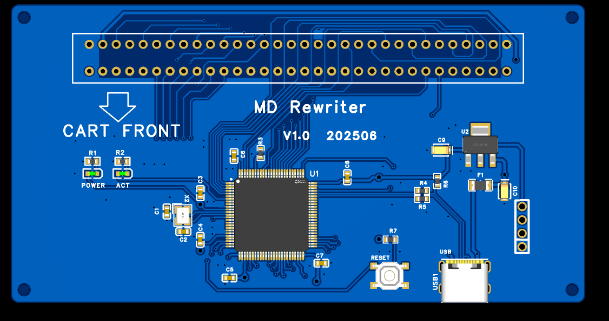
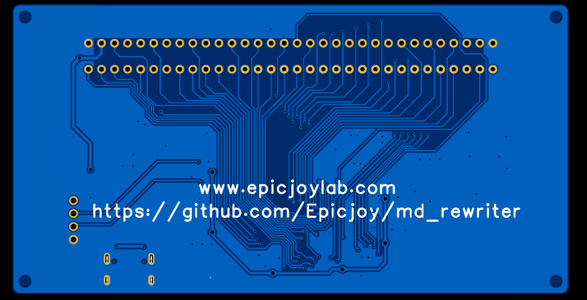

# MD Rewriter: пошаговое руководство, от коробки до первой игры

**Языки:** [English](en.md) · [Português (Brasil)](pt-BR.md) · [Русский](ru.md) · [简体中文](zh-Hans.md) · [हिन्दी](hi.md) · [اردو](ur.md)

Для тех, кто только что получил плату MD Rewriter и мало знает об электронике. Всё описанное сделано на реальном устройстве 13.11.2026; результаты в разделе 9. Если что-то не совпадает с тем, что вы видите, остановитесь и прочитайте раздел 10.

**Коротко.** Плата работает «из коробки» с заводской прошивкой 1.0 (паять не нужно). Прошивка 1.1 необязательна: она правильно записывает flash-картриджи за один проход и распознаёт больше микросхем, но для её установки нужно припаять небольшую гребёнку к плате, иметь программатор ST-Link V2 и около часа времени. **Flash-картриджи семейства KY / FlashKit вмещают не более 2 МиБ игры (раздел 8).**

---

## 0. Правила безопасности

1. **Никогда не записывайте, не стирайте и не «пробуйте» оригинальные игровые картриджи** (проданные с играми). Это маскированные ROM: их нельзя записать, и попытка может только навредить. Программа читает их безопасно; это всё, что с ними делают.
2. **Только один источник питания.** Либо USB-кабель платы, либо провод 3,3 В от ST-Link, никогда оба сразу.
3. **Картриджи вставляют и вынимают только при отключённом USB-кабеле.**
4. **Делайте резервную копию перед стиранием или перезаписью** (flash-картридж с игрой и прошивка платы).
5. Паяльник обжигает (около 350 °C). Работайте в проветриваемом месте, мойте руки после пайки (припой может содержать свинец), дайте паяльнику остыть перед хранением.
6. Прикоснитесь к заземлённому металлическому предмету, прежде чем брать плату, и не держите её за слот картриджа.

---

## 1. Что понадобится

| Предмет | Для чего | Нужен? |
|---------|----------|--------|
| Плата MD Rewriter (V1.0) | само устройство | да |
| USB-кабель **с линиями данных**, лучше USB-A — USB-C (см. 3.2) | подключает плату к компьютеру | да |
| Компьютер с Linux (проверено) или Windows | запуск программы | да |
| Flash-картридж (S29GL064N, тип KY / FlashKit) | запись игр | для записи |
| Игровой картридж Mega Drive | резервная копия | для чтения |
| Программатор ST-Link V2 (оригинал или распространённый USB-клон) | установка прошивки 1.1 | необязательно |
| Штыревая гребёнка 1×4, шаг 2,54 мм | припаять к SWD-площадкам | вместе с ST-Link |
| 4 провода Dupont (гнездо) | соединить ST-Link с гребёнкой | вместе с ST-Link |
| Паяльник 25–40 Вт с тонким жалом, припой 0,6–0,8 мм с флюсом | пайка гребёнки | вместе с ST-Link |
| Оплётка для выпайки, флюс-маркер, изопропиловый спирт, кисточка | очистка и переделка паек | очень полезно |
| Мультиметр с прозвонкой | проверка паек и площадок | вместе с ST-Link |
| Скотч или «третья рука» | держит плату | полезно |

---

## 2. Знакомство с платой



| Что видно | Что это |
|-----------|---------|
| Два ряда по 32 отверстия вверху, надпись «CART FRONT» и стрелка | **слот картриджа**. Стрелка показывает сторону картриджа, обращённую вперёд: этикетка картриджа смотрит туда же, куда стрелка |
| Разъём USB-C внизу справа | подключение к компьютеру и питание платы |
| Кнопка RESET | перезапуск микроконтроллера (в обычной работе не нужна) |
| Светодиоды POWER и ACT | POWER горит, когда есть питание; ACT — индикатор активности |
| Микросхема U1 (большой квадрат) | микроконтроллер (STM32F103) |
| Четыре круглых отверстия в столбец справа от U1 и над USB-C, под конденсатором C10 | **SWD-площадки**, нужны только для установки прошивки. Надписей на плате нет (раздел 3.1) |
| Четыре отверстия по углам | крепёжные отверстия M3. Поставьте стойки или резиновые ножки, чтобы низ платы не касался стола |



---

## 3. Пайка

Паять нужно только для установки прошивки 1.1 (раздел 6). Если остаётесь на заводской прошивке, переходите к разделу 4.

### 3.1 Гребёнка SWD (4 контакта)

Четыре площадки сверху вниз (разъём USB-C внизу платы):

```
   ●  3V3
   ●  SWCLK
   ●  SWDIO
   ●  GND
 [USB-C]
```

**Перед пайкой.** Отключите всё. Проверьте площадки мультиметром (плата без питания):

1. Режим прозвонки: один щуп на нижней площадке (GND), другой на металлическом корпусе разъёма USB-C. Должен звучать сигнал. Если нет, площадка не та или плата перевёрнута.
2. Позже, при подключённом USB, верхняя площадка покажет 3,3 В относительно GND.

**Пайка по шагам:**

1. Закрепите плату на столе скотчем лицевой стороной вверх. По фото верха найдите четыре отверстия.
2. Вставьте гребёнку 1×4 в отверстия сверху, короткими выводами вниз, пластик лежит на плате. Все четыре вывода должны стоять ровно.
3. Переверните плату. Нагрейте паяльник до 330–350 °C и очистите жало о влажную губку.
4. Коснитесь жалом вывода и площадки одновременно (секунда), затем подайте припой на место пайки (не на жало) на 1–2 секунды, уберите припой, затем паяльник. Сначала паяйте только один вывод.
5. Осмотрите: пайка должна быть блестящей, в форме маленького вулкана, закрывать площадку и вывод. Если она матовая, серая, шариком или с зазором, прогрейте снова с небольшим количеством свежего припоя или удалите оплёткой и переделайте.
6. Проверьте, что гребёнка осталась ровной и прилегает. Исправьте, снова прогрев первую пайку и слегка нажав. Затем пропаяйте остальные три вывода (около 3 секунд каждый, не дольше: от перегрева отслаиваются площадки).
7. Очистите плату изопропиловым спиртом и кисточкой. Осмотрите четыре пайки лупой или камерой телефона: нет перемычек между соседями, нет пропусков.
8. **Проверка мультиметром, плата отключена:**
   - Площадка GND: прозвонка до корпуса USB-C (как раньше).
   - Между соседними выводами (3V3 и SWCLK, SWCLK и SWDIO, SWDIO и GND) сигнала быть **не должно**. Сигнал означает перемычку припоя: уберите оплёткой.
   - Покачайте каждый вывод ногтем: ни один не должен шататься. **Незапаянный вывод GND стоил нам нескольких часов на первом устройстве** (связь с ST-Link обрывалась каждые несколько минут и выглядела как ошибка программы). Если что-то шатается, прогрейте этот вывод.

### 3.2 USB-C: кабель

На плате V1.0 у разъёма USB-C нет резисторов 5,1 кОм на линиях CC (замечание H1 в `docs/HARDWARE_REVIEW.md`). Поэтому кабель USB-C — USB-C, подключённый к зарядке или новому ноутбуку, может **не дать питания**. Используйте **кабель USB-A — USB-C с линиями данных**: он работает всегда. Опытные могут исправить это, припаяв два резистора 0603 по 5,1 кОм от площадок A5 и B5 разъёма к GND; если вы не умеете паять детали 0603, возьмите кабель A — C.

---

## 4. Сборка и разборка

### 4.1 Сборка (всё отключено)

Для **обычной работы** (без прошивки): подключите USB-кабель к плате и компьютеру, затем вставьте картридж (4.3).

Для **установки прошивки** (раздел 6): сначала подключите ST-Link при **отключённом** USB-кабеле платы и **пустом** слоте картриджа.

1. Включайте ST-Link в USB-порт компьютера только после подключения проводов.
2. Подключайте провода Dupont всегда по названию, напечатанному на ST-Link, а не по цвету или положению (клоны различаются):

| Контакт гребёнки (сверху вниз) | Цепь | Провод ST-Link |
|--------------------------------|------|----------------|
| 1 | 3V3 | `3.3V` (см. примечание о питании ниже) |
| 2 | SWCLK | `SWCLK` |
| 3 | SWDIO | `SWDIO` (у некоторых клонов `SWIO`) |
| 4 | GND | `GND` |
| нет | NRST | `RST` оставьте свободным: площадки NRST на плате нет |

Контакт `5V` ST-Link остаётся неподключённым.

**Примечание о питании.** Предпочтительный способ, стабильный на стенде: только провода `GND`, `SWCLK` и `SWDIO`, **без** провода `3.3V`, а плата питается от собственного USB-кабеля. Если подключить плату к компьютеру нельзя, используйте провод `3.3V` при отключённом USB и пустом слоте; выход 3,3 В у клона слабый, поэтому держите тесты короткими.

3. Ещё раз осмотрите четыре соединения. Нажмите пальцем на каждый разъём Dupont: плохой контакт — самая частая проблема.

### 4.2 Разборка после работы

1. Закройте программу. 2. Отключите USB-кабель платы. 3. Подождите несколько секунд, пока погаснут светодиоды. 4. Выньте картридж (4.3). 5. Снимите разъёмы Dupont с гребёнки **за пластик, прямо вверх**, никогда за провод. 6. Отключите ST-Link от компьютера.

Гребёнка может остаться на плате, это не мешает. Чтобы убрать её: прогрейте один вывод и вытащите пинцетом или плоскогубцами; либо перекусите пластик бокорезами и удалите выводы по одному; очистите отверстия оплёткой. Никогда не грейте площадку дольше нескольких секунд: она отслоится. Храните плату в антистатическом пакете или коробке, вдали от металла.

### 4.3 Установка и извлечение картриджа

- При **отключённом USB-кабеле**.
- Держите картридж за пластик так, чтобы **этикетка смотрела в сторону стрелки «CART FRONT»** на плате. Прижмите прямо вниз в слот до упора, равномерно, не качая и не поворачивая.
- Чтобы вынуть, тяните прямо вверх, также при отключённом USB. Не тяните за плату или USB-кабель.
- Не меняйте картриджи при включённом питании платы: картридж и плата используют общие линии и могут выйти из строя.

---

## 5. Установка программы

Следуйте разделу «Установка программы» в README (Linux: `.deb` или tar.gz со страницы релизов, либо сборка из исходников; Windows: сборка из исходников). В Linux дайте пользователю доступ к последовательному порту: `sudo usermod -aG dialout $USER` и войдите заново, либо установите правило udev `Software/linux/99-md-rewriter.rules`.

Проверьте, что программа общается с платой: подключите плату (без картриджа), запустите программу, нажмите **Refresh**, затем **Connect**. В журнале появится `Device identified.`. В командной строке:

```
mdrewriter-cli ports        # плата отображается как 0483:5740
mdrewriter-cli info         # показывает версию прошивки
```

Если появилось «permission denied», исправьте права на последовательный порт (см. выше). Если плата не видна, возьмите другой кабель (с линиями данных).

---

## 6. Установка прошивки 1.1 (необязательно, около часа)

Зачем: с прошивкой 1.0 запись на flash-картридж S29GL064N оставляет половину слов пустыми (программируется каждое второе слово) и требует восьми проходов исправления. Прошивка 1.1 записывает и проверяет игру за один проход и называет микросхему. Прошивка 1.1 — та же программа с добавленным ожиданием окончания записи; она проверена на первом устройстве (раздел 9).

Нужны ST-Link V2, припаянная гребёнка (раздел 3) и программы `st-info` и `st-flash` (Linux: `sudo apt install stlink-tools`). Скрипту `tools/swd/swd.sh` нужны Linux или macOS с `bash`. В Windows выполните те же команды вручную (6.5).

### 6.1 Соедините провода

Раздел 4.1: провода `GND`, `SWCLK`, `SWDIO`, USB-кабель платы подключён, слот картриджа пуст.

### 6.2 Проверьте связь

```
tools/swd/swd.sh probe
```

Ожидается: `swd: probe ok (0x414, 524288 bytes)` (у наших устройств STM32F103xE с 512 КиБ; `0x410` с 131072 байтами тоже подходит). `chip id 0x0` или «no ST-Link found» означает плохое соединение: сначала проверьте **GND на гребёнке**, затем SWCLK и SWDIO (поменяйте их местами, если связь так и не появляется), затем кабель. Скрипт сам повторяет оборвавшееся соединение.

### 6.3 Сделайте копию заводской прошивки

```
tools/swd/swd.sh backup --out ~/md_rewriter_backups/fw-factory
```

Он читает микросхему дважды, сравнивает чтения и записывает `fw-factory.bin` с файлом `.sha256`. **Если сказано, что чтение пустое, остановитесь**: включена защита от чтения, заводскую прошивку сохранить нельзя; не стирайте и не прошивайте. Скопируйте копию на второй носитель (другой диск или флешку).

### 6.4 Запишите прошивку 1.1

Скачайте `md-rewriter-firmware-1.1.0.bin` (и `.sha256`) со страницы релизов этого репозитория, проверьте через `sha256sum -c` и выполните:

```
tools/swd/swd.sh flash md-rewriter-firmware-1.1.0.bin --backup ~/md_rewriter_backups/fw-factory/fw-factory.bin --yes
```

Скрипт проверяет, что в микросхеме всё ещё прошивка из копии, записывает, читает обратно и сравнивает. Завершается словами `written and verified`. После этого **отключите и снова подключите USB-кабель платы** (программный сброс не всегда заставляет плату определиться по USB). Проверка: `mdrewriter-cli info` должен показать `firmware 1.1.0`.

**Чтобы вернуть заводскую прошивку:** `tools/swd/swd.sh restore --backup ~/md_rewriter_backups/fw-factory/fw-factory.bin --yes`.

### 6.5 Windows (вручную)

Установите инструменты ST-Link (релиз `stlink` с `st-info.exe` и `st-flash.exe` или STM32CubeProgrammer). Эквивалентные команды: `st-info --probe`; `st-flash read backup.bin 0x08000000 0x80000` (используйте `0x20000`, если `st-info` показывает 128 КиБ); `st-flash write md-rewriter-firmware-1.1.0.bin 0x08000000`; прочитайте обратно и сравните первые байты с файлом. Берегите копию.

---

## 7. Проверьте своё устройство, шаг за шагом

Каждый шаг можно выполнить в графической программе (GUI) или в командной строке (CLI); результаты одинаковы. В примерах CLI порт находится сам; если последовательных устройств несколько, добавьте `--port /dev/ttyACM0` (Linux) или `--port COM3` (Windows). Названия кнопок приведены по-английски: у программы нет русского перевода (есть английский и португальский).

Выполняйте тесты в этом порядке. Если шаг не удался, остановитесь и прочитайте раздел 10.

| № | Тест | GUI | CLI | Что должно получиться |
|---|------|-----|-----|-----------------------|
| 1 | Версия (без картриджа) | **Connect** | `mdrewriter-cli info` | `Device identified.` и прошивка `1.1.0` (или `1.0` с заводской) |
| 2 | Пустой слот | **Detect cartridge** | `mdrewriter-cli detect` | flash-микросхема не найдена; чтение пустого слота даёт только `0xFF` |
| 3 | Оригинальная игра, только чтение | вставьте картридж, **Detect cartridge**, **Cartridge size** 2 MiB (или размер игры), **Read ROM…** | `mdrewriter-cli read-rom --size 2M --out game1.bin` | дамп создан (около 12,5 с на 2 МиБ). У картриджа с маскированной ROM `detect` показывает flash id `0000` или «unknown chip»: это **не** flash-картридж, никогда не пишите в него |
| 4 | Прочитать дважды и сравнить | прочитайте тот же картридж ещё раз в `game2.bin`, **Compare files…** | `mdrewriter-cli compare game1.bin game2.bin` | различий нет. Разные результаты означают плохой контакт: очистите контакты картриджа и повторите |
| 5 | Flash-картридж: распознавание | вставьте flash-картридж, **Detect cartridge** | `mdrewriter-cli detect` | `S29GL064N ... Supported` и строка `Chip codes 017E1001 (или 017E1000), CFI sector words ...` |
| 6 | **Сделайте копию содержимого flash-картриджа** | **Read ROM…** 2 MiB и **Read save…** | `read-rom --size 2M --out old.bin`, `read-save --size 32K --out old.srm` | оба файла созданы. Сохраните их, если на картридже есть нужное |
| 7 | Стереть 2 МиБ | **Erase by size…** при **Cartridge size** 2 MiB, подтвердите | `mdrewriter-cli erase 2M --yes` | `Erase complete.` за 6–9 секунд; новое чтение даёт только `0xFF` |
| 8 | Записать ROM (до 2 МиБ) | **Write ROM…**, выберите `.bin`/`.md`/`.gen`/`.smd`, оставьте включённым **Verify after writing**, подтвердите | `mdrewriter-cli write-rom game.bin --yes` | `Game written`, затем `Verified: the … bytes read back match the file.` Около 90 с на 2 МиБ |
| 9 | Проверить ещё раз | **Read ROM…** и **Compare files…** с оригиналом | `mdrewriter-cli verify game.bin` | совпадают |
| 10 | Данные сохранений | **Read save…** дважды, сравните | `read-save --size 32K --out s1.srm`, снова `s2.srm`, `compare s1.srm s2.srm` | файлы совпадают |

**Не выполняйте** шаги стирания и записи на картридже, который не является flash, на картридже с игрой, копии которой у вас нет, и когда подключено что-то ещё.

### Набор тестов, который мы использовали (необязательно, только чтение)

Стендовый набор читает плату и картридж и **никогда не пишет и не стирает** (у него нет `--yes`). Нужен Python 3:

```
python3 tools/hwtest/hwtest.py nocart --port ttyACM0 --expect-fw 1.1          # слот пуст
python3 tools/hwtest/hwtest.py cart   --port ttyACM0 --expect-fw 1.1 --rom-size 2M   # с картриджем
```

Он показывает PASS / FAIL / INFO / SKIP по каждой проверке и сохраняет отчёт в `test-results/`. С `--rom-size 8M` читаются также 8 МиБ (на flash-картриджах вторые 4 МиБ повторяют первые: это нормально, раздел 8).

---

## 8. Предел 2 МиБ у flash-картриджей

**Flash-картриджи семейства KY / FlashKit вмещают не более 2 МиБ игры, каков бы ни был размер, указанный на микросхеме (S29GL064N — 8 МиБ).** Мы проверили два (картридж KY и второй картридж S29GL064N), и оба ведут себя одинаково:

- Стирание и запись выше 2 МиБ не удаются: `erase 4M` останавливается с `A sector did not finish erasing in time` примерно через 23 секунды, а игру больше 2 МиБ записать нельзя.
- Чтение выше 2 МиБ показывает **RAM сохранений** (каждый второй байт `0xFF`), а не flash: плата картриджа выбирает flash только для нижних 2 МиБ, а RAM для верхних 2 МиБ. Чтение 8 МиБ дважды повторяет одни и те же 4 МиБ.

Так устроена плата картриджа (её дешифратор адреса, `docs/HWTEST.md`), это не неисправность MD Rewriter, прошивки или программы. Никакая настройка этого не меняет; мы пробовали регистры маппера оригинального программатора.

**Что помещается:** почти любая игра Mega Drive (большинство от 512 КиБ до 2 МиБ; Metal Gear, 2 МиБ, записан и проверен на обоих картриджах). **Что не помещается:** игры больше 2 МиБ, например Super Street Fighter II (4 МиБ, с маппером банков). Для них нужен другой картридж: простой flash-картридж на 4 МиБ без такого дешифратора (например открытый проект `MD-Flash-Cart-4MB`, MX29LV320 или MX29L3211) или картридж с маппером банков.

---

## 9. Что проверено на первом устройстве

Первое устройство, 13.11.2026. Прошивка 1.1.0-test (та же программа, что и 1.1.0, отличается только текст версии).

| Проверка | Результат |
|----------|-----------|
| Плата | микроконтроллер STM32F103xE, 512 КиБ flash (в файлах проекта указана деталь на 128 КиБ); прошивка 1.1 помещается |
| Копия заводской прошивки | прочитана дважды, одинаково, защиты от чтения нет. (Команда `restore` проверена только на ПК с имитацией инструментов; на устройстве не запускалась) |
| Прошивка 1.1 записана по SWD | записана и проверена; плата определяется как `0483:5740` и работает с программой |
| Пустой слот | два чтения совпадают, только `0xFF` |
| Оригинальный картридж (Rolling Thunder 2), только чтение | 2 МиБ прочитаны дважды за 12,4 с, совпадают, как и с прошивкой 1.0. Никогда не записывался |
| Flash-картридж S29GL064N, прошивка 1.0 | записывает только каждое второе слово: нужны проходы исправления |
| Flash-картридж S29GL064N и картридж KY, прошивка 1.1 | распознаны как `S29GL064N`; стирание 2 МиБ за 6–9 с; Metal Gear на 2 МиБ записан и проверен **за один проход** (около 90 с с обратным чтением); дамп равен файлу |
| Записанные картриджи на настоящей консоли | владелец проверил картриджи, записанные этой прошивкой, на настоящей Mega Drive (сообщено 13.11.2026) |
| Запись поверх данных без стирания | `WRITE TIMEOUT` за 0,4 с, плата продолжает отвечать: безопасный отказ |
| У двух flash-картриджей с одним ID микросхемы разная структура секторов | поэтому прошивка всегда стирает малыми шагами, что работает на обоих |
| Запись или стирание выше 2 МиБ | на этих двух картриджах невозможны (раздел 8) |

Ещё не проверено: чтение через маппер банков SSF2, запись при пропадании питания, сборка с буфером записи и flash-картриджи других марок.

---

## 10. Если что-то не так

| Симптом | Что делать |
|---------|------------|
| Плата не видна на компьютере | Возьмите кабель USB-A — USB-C с линиями данных. Попробуйте другой USB-порт. Светодиод POWER должен гореть |
| «permission denied» (Linux) | `sudo usermod -aG dialout $USER`, войдите заново или установите правило udev |
| `probe` показывает `chip id 0x0` или ничего не находит | Сначала проверьте **GND на гребёнке** (обычная причина — плохо припаянный вывод), затем SWCLK и SWDIO, затем прижмите разъёмы Dupont. Скрипт сам повторяет попытки |
| `swd.sh` говорит, что в микросхеме не прошивка из копии | Это другое устройство или изменённое. Сначала сделайте новую копию; никогда не прошивайте без копии |
| После прошивки плата не определяется по USB | Отключите и снова подключите USB-кабель платы |
| `detect` говорит «unknown chip» | Это не flash-картридж (оригинальный) или микросхемы нет в таблице: не записывайте |
| «did not finish erasing» | Картридж не flash, неисправен или вы запросили больше 2 МиБ (раздел 8) |
| `WRITE TIMEOUT` | Область не была стёрта (сначала стереть, потом записывать) или микросхема неисправна |
| Проверка не проходит | Очистите контакты картриджа, возьмите другой USB-кабель, повторите стирание и запись |
| Два чтения одного картриджа различаются | Плохой контакт: очистите контакты изопропиловым спиртом и вставьте снова |
| Записанная игра не запускается на консоли | Проверьте, что файл — допустимая ROM (программа предупреждает о проблемах заголовка), что размер не больше 2 МиБ и что проверка прошла |

Если вы нашли то, чего здесь нет, создайте issue с журналом программы и выводом `mdrewriter-cli detect`.
